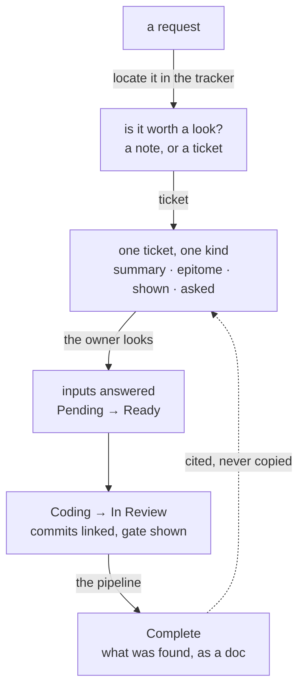

<m-summary>

<m-answer data-field="answer">**How work is ticketed, planned, asked, built and reported on menger — the methodology written from the ground up for the surface it runs on, in menger's own terms, and shown on that surface: every skill here is a file in this repository, its worked examples built into it and drawn by menger.**</m-answer>

<m-stat value="11">skills</m-stat>
<m-stat value="6">forms, one per kind</m-stat>
<m-stat value="4">worked examples, built in</m-stat>

</m-summary>

<m-beat data-field="problem" kicker="the premise · the owner, 2026-10-13" size="lead">

A ticket is only relevant if a human being looks at it. The more tickets we construct, the less likely a human is to review them all.

*"We want tickets to be engaging and to show examples of how something should work. We want a visual masterpiece: diagrams, and in the case of frontends, the components rendered directly into the surface."*

<svg slot="figure" viewBox="0 0 240 160" role="img" aria-label="a page with a picture on it, and an eye looking at it"><rect x="30" y="18" width="150" height="124" rx="6" style="fill:none;stroke:var(--ink);stroke-width:2"></rect><path d="M46 38 H120" style="stroke:var(--ink);stroke-width:5;stroke-linecap:round"></path><rect x="46" y="54" width="118" height="52" rx="4" style="fill:var(--accent);opacity:.85"></rect><path d="M46 120 H140 M46 130 H110" style="stroke:var(--line);stroke-width:3;stroke-linecap:round"></path><path d="M196 80 Q214 60 232 80 Q214 100 196 80 Z" style="fill:none;stroke:var(--ink);stroke-width:2.5"></path><circle cx="214" cy="80" r="6" style="fill:var(--ink)"></circle></svg>

</m-beat>

<m-field data-field="context" label="What follows from it">

A ticket is written for the moment a person opens it, and it earns that moment by **showing** — the shape as a diagram, the behaviour as a walk or a playable, the frontend as the component itself — rather than describing. The surface is assumed: a body is HTML and markdown in a sandboxed frame with menger's house components, live chips, cites, inputs and themes. Where a thing cannot be built into the frame, the ticket carries a screenshot. A body that only tells is not finished.

The agent is the second reader. It reads the same body for its structure — the fields, the tables, the contracts — and that structure is what makes the body checkable. One body, two readers: the person gets the arc, the agent gets the fields, and neither is written at the other's expense.

</m-field>

<m-diagram data-field="end-state" label="The arc">

A request is placed before it is written; a ticket is filed when someone is about to look at it; the owner answers in the ticket; the builder shows the gate on it; what was found is a doc the next ticket cites.

</m-diagram>

<m-cases label="The skills">

| skill | produces | use when |
| -- | -- | -- |
| [surface](surface/SKILL.md) | the vocabulary: what a body on menger can show, ask, cite and wear | before writing any body; whenever a component or field is in doubt |
| [ticketing](ticketing/SKILL.md) | one ticket a person will look at — the summary, the epitome, the ladder down, what it shows | turning anything into a ticket |
| the forms |  [scope](ticketing/scope.md), [execution](ticketing/execution.md), [build](ticketing/build.md), [spike](ticketing/spike.md), [gap](ticketing/gap.md), [doc](ticketing/doc.md) | one per kind |
| [planning](planning/SKILL.md) | as few tickets as the work needs, placed under what exists, the DAG on the execution, the forks as inputs | a request bigger than one diff |
| [asking](asking/SKILL.md) | a question the owner answers in the ticket, and the act that closes it | any fork, bet or reply the agent may not make itself |
| [building](building/SKILL.md) | a build carried Ready → Coding → In Review with its branch, gate and commits on the ticket | implementing a promoted ticket |
| [showing](showing/SKILL.md) | the right picture: a diagram, a figure, a walk, a playable, the component itself, a screenshot | any body; always for a frontend |
| [reporting](reporting/SKILL.md) | a doc that answers first and hides nothing | a spike's result, a survey, a status |
| [theming](theming/SKILL.md) | a project's look, as a theme ticket adopted at a reach | a shortcode with a reader of its own |
| [systems](systems/SKILL.md) | what a ticket shows for each kind of system — there is no one size | a backend, a frontend, a CLI, a schema, a pipeline, a method |
| [reaching](reaching/SKILL.md) | the synapse calls a writer and a builder use against menger | any write to the tracker |
| [the decisions](docs/adr/README.md) | [0001](docs/adr/0001-a-ticket-is-only-relevant-if-a-human-looks-at-it.md) a ticket is only relevant if a human looks at it · [0002](docs/adr/0002-the-examples-are-live-tickets.md) the examples were live (superseded) · [0003](docs/adr/0003-assume-the-menger-surface.md) assume the surface · [0004](docs/adr/0004-the-examples-are-built-into-the-skill.md) the examples are built into the skill | how this repository works |

</m-cases>

<m-field data-field="detail" label="The examples are built in">

Unlike a methodology written in the abstract, this one shows its rules on worked examples — each a whole ticket body, house components and all, kept as a file in the skill whose rule it illustrates (`<skill>/examples/`). A skill reads nothing from the tracker: an example is opened as a file, and drawn from the file.

The pictures in the last column are built, not kept: `bin/build` draws each example file through the menger deployed on this machine (prod by default, `MENGER_ENV=test` for the test environment), reading and writing no ticket, and fails if that menger is not online.

| example | demonstrates | the files | drawn |
| -- | -- | -- | -- |
| Volt (`AMP`) | a fullstack REST + binary-RPC + Plexus project, one ticket of every kind; a parent that zooms into its children by citing them | [scope](ticketing/examples/scope.md) · [execution](ticketing/examples/execution.md) · [spike](ticketing/examples/spike.md) · [build](ticketing/examples/build.md) · [gap](ticketing/examples/gap.md) · [doc](ticketing/examples/doc.md) · [report](reporting/examples/report.md) · [theme](theming/examples/volt.md) | [scope](shots/scope.png) ([dark](shots/scope.dark.png)) · [execution](shots/execution.png) · [spike](shots/spike.png) · [build](shots/build.png) · [gap](shots/gap.png) · [doc](shots/doc.png) · [report](shots/report.png) |
| Kiln (`CONE`) | pitch-and-appetite planning as a ticket: the pitch, the appetite, the breadboard, a live hill, a stretch throttle | [pitch](ticketing/examples/pitch.md) · [theme](theming/examples/kiln.md) | [pitch](shots/pitch.png) |
| Allot (`PLOT`) | a pattern language: every ticket returns to the picture above it before it elaborates | [pattern](ticketing/examples/pattern.md) · [3](ticketing/examples/pattern-person.md) · [4](ticketing/examples/pattern-list.md) · [5](ticketing/examples/pattern-names.md) · [theme](theming/examples/allot.md) | [pattern](shots/pattern.png) |
| Brew (`ROAST`) | the feed: recency, unread, a streak, an open loop — every number true, and an end | [feed](showing/examples/feed.md) · [theme](theming/examples/brew.md) | [feed, dark](shots/feed.dark.png) |

The ids in the examples (`AMP-4`, `CONE-1`, …) are the examples' own, made up for them: the shortcodes `AMP`, `CONE`, `PLOT`, `ROAST` and `HOME` are none of the tracker's.

</m-field>

<m-field data-field="decided-shape" label="One file, two readers">

1. **The repository is the source of truth.** Each skill is its `SKILL.md` (and, for ticketing, the forms beside it) and the examples under it; nothing here is mirrored from the tracker, and nothing on the tracker is read to use it.
2. **An example is a file in its skill.** A rule that is shown is shown on a body kept in `<skill>/examples/`: the frontmatter says who the example is (its made-up id, kind, status, title, theme) and, under `tracker:`, the rows its live components read; another skill links to it, never copies it.
3. **A harness loads the file.** A coding agent's harness reads `SKILL.md` as text, HTML included, and ignores the frontmatter keys it does not know; a link to an example is a file it opens.
4. **The surface draws it.** `bin/build` frames each example as menger frames a body — the house components, the cites between examples, the themes they wear — through the menger running here, and `shots/` holds what it drew. When menger opens a file by URI, a skill is opened where it is read.

</m-field>

<m-field data-field="edges" label="Relation to ought">

`../ought` was the methodology in the abstract, with every context stripped out. It is retired (owner, 2026-10-14): this repository is the house methodology, and nothing reads ought any more. What ought got right — the two-stranger test, contracts on the edges, spikes for unknowns, the human ratifying at the forks, the tracker as the source of truth — is kept here, rebuilt around the page a person opens. The synapse invocation contract moved into [reaching](reaching/SKILL.md).

</m-field>
