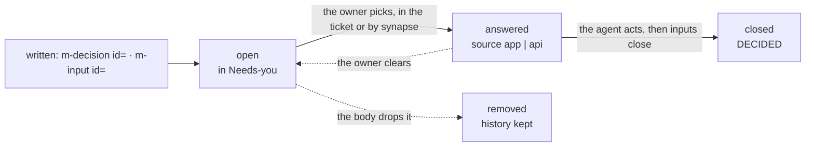

<m-summary>

<m-answer data-field="answer">**A question for the owner is an input on the ticket, asked after the body has shown enough to answer it, and mentioned in chat only with the ticket id.**</m-answer>

<m-stat value="3">kinds of input: a decision, a multi, a text</m-stat>
<m-stat value="0">questions that live only in chat</m-stat>

</m-summary>

<m-diagram data-field="shape" label="An input's life">



Open, answered, closed, removed — every answer kept with its history, queryable.

</m-diagram>

<m-cases label="The three inputs">

| ask | write | the answer |
| -- | -- | -- |
| pick one | `<m-decision data-field="decision" id="policy" rows="who waits\|cost">` with an `m-question`, two or more `m-option name value recommended …`, an `m-recommendation by` | a choice, with a rationale |
| pick a look | the same decision, **a mockup in each option** (below) | a choice, picked on its mockup |
| tick any | `<m-input id="house" kind="multi">` with an `m-question` and `m-choice value recommended` items | the ticked values (none is an answer too) |
| reply | `<m-input id="notes" kind="text">` with an `m-question` | free text |

</m-cases>

<m-field data-field="context" label="Where it goes in the body">

After the reader has seen what they need to answer it, and before the contract: the epitome, the shape, the playable — then the question. A bet at the top of a scope the owner has not read yet is answered on the title. The scope example, [../ticketing/examples/scope.md](../ticketing/examples/scope.md), puts the policy decision after the surface and before the language, and its recommendation points at the build example's playable: *guess, press go, then decide here.* The `id` is what makes it live: unique in the ticket; a duplicate refuses the write. Without an `id` the same markup only displays (a recorded decision in a spike, with its `m-answer`). That decision is its `decision` field (`shots/scope.png`); filed, it is answered in its own ticket.

</m-field>

<m-field data-field="decided-shape" label="A decision between looks (APP-46)">

When the options are looks — a layout, a screen, a component's state — **each option holds its mockup**, so the owner decides on the thing and not on a description of it. Put an `<m-mockup>` (or a ` ```mockup ` fence, blank lines around it) inside each `<m-option>`, one view each (showing: *a mockup is one view*), its `description` saying what the view shows; the option's rows still carry the cost and the benefit. The app draws each option's mockup in its card with **pick this** on the mockup's bar: the owner's click records that option as the decision's answer, exactly as the card's own radio and Submit would (source `app`). The answer's mockup is marked, and once the input is closed (DECIDED) the chosen option is drawn first. **comment** on the same bar leaves feedback on that option's mockup without entering annotation mode — read it with `comments list --under …`, act on it, as for any comment. Nothing inside a mocked page answers an input: the pick is always on the bar.

<m-code lang="markdown" why="three looks, each its own option and its own mockup">

```markdown
<m-decision data-field="decision" id="look" rows="cost|benefit">

<m-question data-field="question">Which board ships?</m-question>

<m-option data-field="option" name="Dense" value="dense" recommended cost="more to scan" benefit="40 rows on one screen">

<m-mockup widths="390,1440" description="The board at 40 rows, one line each.">
<!doctype html>…the dense board…
</m-mockup>

</m-option>

<m-option data-field="option" name="Cards" value="cards" cost="8 rows a screen" benefit="room for a preview">

<m-mockup widths="390,1440" description="The board as cards, a preview each.">
<!doctype html>…the cards…
</m-mockup>

</m-option>

<m-recommendation data-field="recommendation">Dense: the owner scans more than reads.</m-recommendation>

</m-decision>
```

</m-code>

</m-field>

<m-field data-field="decided-shape" label="Rules">

1. **Filed, never only in chat** (the owner, 2026-10-12). A question that lives in a transcript is never seen. Put it on the ticket as an input — or, when it is not a choice or a reply, label the ticket `needs-you` with the reason in the body — and only then say so in chat, with the id.
2. **The agent never answers its own input.** It recommends (one option `recommended`, the `m-recommendation` saying why) and waits.
3. **Every option is a real system.** Each card says what exists if it is picked, in rows the cards share, so costs compare at a glance. Two options that differ only in wording is one option.
4. **One recommendation, always.** "None — the evidence doesn't pick" is written only when true.
5. **The human keeps the signature.** Appetite, answer, placement on the hill: a number the owner sets is marked as the owner's (a dot *placed by the owner*), never overwritten by a status.
6. **Read the state before acting.** An answer may be cleared while the input is open.
7. **Act, then close.** `inputs close` freezes it; the component shows DECIDED. A question that must be asked again is `inputs reopen`.
8. **A playable is not an answer.** A guess made in a simulation records nothing; the decision is the input beside it.
9. **Work the owner told you to do is urgent.** A question that stops it is queued, not only filed (owner, 2026-10-15). Below.
10. **Queued, then listen.** After queueing, wait on the ticket with `await_reply` (in the background where the harness allows it), act on what it yields, then close the input or queue again. Never queue and then just stop (owner, 2026-10-15). Below.

</m-field>

<m-field data-field="decided-shape" label="When it cannot wait: the queue">

A filed input waits until the owner looks. **Queueing** puts the ticket in front of the owner: a tab in the tray along the bottom edge of every open app, which flashes as it arrives, with an urgency and a reason. The urgencies are `whenever` · `today` · `now` · `blocking`. `blocking` names the `--input` the caller is idle on; closing that input unqueues the ticket.

**Two tiers: every question shown, only the important queued** (owner, 2026-10-17: *"we don't want to overpopulate the queue with every question … all questions available, which should always show; and important (those brought in via the actual queue)"*). Every filed input is always shown to the owner under Needs you, with nothing more to do. Queue only the important ones, as the table below says: a question that stops work the owner asked for, or something that cannot wait. APP-51 builds the two tiers in the app.

**When the owner told you to work on it, queueing is urgent** (owner, 2026-10-15). The owner is waiting on that work, so a question that stops it is theirs to answer now, not when they next look at the tracker. File the input first, then queue the ticket at once:

| the work is | the question | queue it at |
| -- | -- | -- |
| what the owner told you to do | you are idle until it is answered | `blocking`, with `--input` |
| what the owner told you to do | you can carry on around it | `now` |
| your own, or background | it can wait for the owner's next look | don't queue it: it shows under Needs you |

Say what you are waiting on in the `--reason`, in a sentence the owner can act on from the tab. Then say so in chat, with the id. Outside work the owner asked for, keep `now` and `blocking` for what is so (a promote that rolled back, a gap on prod). A queue that is always loud is a queue the owner learns to ignore.

</m-field>

<m-field data-field="decided-shape" label="After queueing: listen for the reply">

**An agent that queues a question waits on the ticket for the response** (owner, 2026-10-15: *"when queued an agent should then listen to that ticket for a response"*). Right after `queue`, run `tickets await_reply` on the same ticket, in the background where the harness allows it. It yields `waiting` at once, then one `replied` when the owner responds, and ends.

| `reply.kind` | the owner | the agent then |
| -- | -- | -- |
| `answered` | answered an input (with `--input`: that one) | read the state, act on the answer, `inputs close` |
| `changes_requested` | pressed *Request changes* in the tray: the comment says what to change, and the ticket is out of the queue | change the ticket (its body, the options, the work), then queue it again |
| `commented` | left a comment on the ticket | read it; act, answer in a comment, or ask again |
| `unqueued` | took it out of the queue (`done with it`), or its input was closed (`closed`) | read the ticket: it may be decided, or no longer wanted |
| `ended` | canceled or deleted the ticket | stop the work |

A snooze is not a response: the wait goes on. If the connection drops, call again with `--since` set to the time you queued, and nothing is lost. `--timeout-minutes` ends the wait with `timed_out`. Then say so in chat and pick it up later. Never queue and then just stop.

</m-field>

<m-code lang="bash" why="queueing: the input first, then the ticket; queueing again only raises the urgency">

```bash
synapse -P 4455 menger tickets queue --id AMP-4 --urgency blocking --input policy --reason "the build is idle until the policy is picked"
synapse -P 4455 menger tickets queue --id AMP-6 --urgency now --reason "the import runs around it; which file wins is yours"
synapse -P 4455 menger tickets queued                  # most urgent first
synapse -P 4455 menger tickets unqueue --id AMP-6      # withdrawn, or done with
```

</m-code>

<m-code lang="bash" why="after queueing: wait for the owner's response, in the background; one replied, then the end">

```bash
synapse -P 4455 -j menger tickets await_reply --id AMP-4 --input policy --timeout-minutes 240 | jq -c 'select(.type == "data") | .content'
# {"type":"waiting","ticket":"AMP-4","queued":{…}}
# {"type":"replied","ticket":"AMP-4","reply":{"kind":"answered","input":"policy","value":{"type":"choice","option":"fair"},"source":"app","at_unix":…}}
synapse -P 4455 -j menger tickets await_reply --id AMP-4 --since 1792072000     # after a dropped connection: nothing lost
synapse -P 4455 menger tickets request_changes --id AMP-4 --body "neither: …"   # the owner, from a shell: what the tray's Request changes sends
```

</m-code>

<m-code lang="bash" why="reading what waits, closing what was acted on">

```bash
synapse -P 4455 menger tickets inputs list --state open                      # everything waiting
synapse -P 4455 menger tickets inputs list --ticket AMP-1                  # one ticket's, with history
synapse -P 4455 menger tickets list --filter 'asking or label needs-you' --summary true
synapse -P 4455 menger tickets inputs close --ticket AMP-1 --input policy
synapse -P 4455 menger tickets inputs reopen --ticket AMP-1 --input policy
synapse -P 4455 menger tickets label --id AMP-6 --add needs-you        # not a choice: the reason is in the body
synapse -P 4455 menger tickets label --id AMP-6 --remove needs-you     # once acted on
```

</m-code>

<m-code lang="bash" why="the owner answering by shell (source api); a multi goes through -p">

```bash
synapse -P 4455 menger tickets inputs answer --ticket AMP-1 --input policy --value.type choice --value.option fair --rationale "a week is fair"
synapse -P 4455 menger tickets inputs answer --ticket T --input notes --value.type text --value.text "ship it"
synapse -P 4455 -p '{"ticket":"CONE-1","input":"house","value":{"type":"multi","options":["stretch","hill"]}}' menger tickets inputs answer
synapse -P 4455 menger tickets inputs clear --ticket AMP-1 --input policy
```

</m-code>

`watch` carries `input_changed`; a component in the body may follow it. The app's Needs-you panel is `asking or label needs-you`; `#/inputs` lists them all.

<m-cases label="Examples">

| asked | how |
| -- | -- |
| well — the [pitch example](../ticketing/examples/pitch.md), `bet` | *Bet on this for the next two weeks?* — two cards, *Bet* and *Shelve it*, rows *what ships · what doesn't · cost*; the recommendation names the spike that already closed the rabbit hole that mattered. The owner answers from the first screen of the pitch |
| badly | *Let me know which approach you prefer* at the end of a chat message. Nothing on the tracker; a week later nobody remembers the options |
| not a choice | a gap whose fix is one of two selectors: filed as a decision `header` on the gap with both selectors as options, the recommendation naming the one that keeps the app's gutter |

</m-cases>

<m-field data-field="execution">The components' markup: <a href="../surface/SKILL.md">surface — what a body on menger can show, ask, cite and wear</a>. Where the question sits in the arc: <a href="../ticketing/SKILL.md">ticketing — one ticket worth a look</a>.</m-field>
