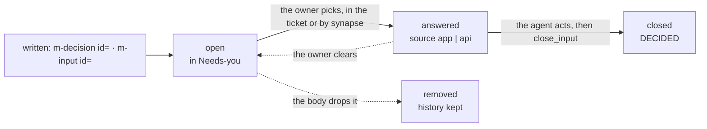

<m-summary>

<m-answer data-field="answer">**A question for the owner is an input on the ticket, asked after the body has shown enough to answer it, and mentioned in chat only with the ticket id.**</m-answer>

<m-stat value="3">kinds of input: a decision, a multi, a text</m-stat>
<m-stat value="0">questions that live only in chat</m-stat>

</m-summary>

<m-diagram data-field="shape" label="An input's life">



Open, answered, closed, removed — every answer kept with its history, queryable.

</m-diagram>

<m-cases label="The three inputs">

| ask | write | the answer |
| -- | -- | -- |
| pick one | `<m-decision data-field="decision" id="policy" rows="who waits\|cost">` with an `m-question`, two or more `m-option name value recommended …`, an `m-recommendation by` | a choice, with a rationale |
| tick any | `<m-input id="house" kind="multi">` with an `m-question` and `m-choice value recommended` items | the ticked values (none is an answer too) |
| reply | `<m-input id="notes" kind="text">` with an `m-question` | free text |

</m-cases>

<m-field data-field="context" label="Where it goes in the body">

After the reader has seen what they need to answer it, and before the contract: the epitome, the shape, the playable — then the question. A bet at the top of a scope the owner has not read yet is answered on the title. The scope example, [../ticketing/examples/scope.md](../ticketing/examples/scope.md), puts the policy decision after the surface and before the language, and its recommendation points at the build example's playable: *guess, press go, then decide here.* The `id` is what makes it live: unique in the ticket; a duplicate refuses the write. Without an `id` the same markup only displays (a recorded decision in a spike, with its `m-answer`). That decision is its `decision` field (`shots/scope.png`); filed, it is answered in its own ticket.

</m-field>

<m-field data-field="decided-shape" label="Rules">

1. **Filed, never only in chat** (the owner, 2026-10-12). A question that lives in a transcript is never seen. Put it on the ticket as an input — or, when it is not a choice or a reply, label the ticket `needs-you` with the reason in the body — and only then say so in chat, with the id.
2. **The agent never answers its own input.** It recommends (one option `recommended`, the `m-recommendation` saying why) and waits.
3. **Every option is a real system.** Each card says what exists if it is picked, in rows the cards share, so costs compare at a glance. Two options that differ only in wording is one option.
4. **One recommendation, always.** "None — the evidence doesn't pick" is written only when true.
5. **The human keeps the signature.** Appetite, answer, placement on the hill: a number the owner sets is marked as the owner's (a dot *placed by the owner*), never overwritten by a status.
6. **Read the state before acting.** An answer may be cleared while the input is open.
7. **Act, then close.** `close_input` freezes it; the component shows DECIDED. A question that must be asked again is `reopen_input`.
8. **A playable is not an answer.** A guess made in a simulation records nothing; the decision is the input beside it.

</m-field>

<m-code lang="bash" why="reading what waits, closing what was acted on">

```bash
synapse -P 4455 menger tickets inputs --state open                      # everything waiting
synapse -P 4455 menger tickets inputs --ticket AMP-1                  # one ticket's, with history
synapse -P 4455 menger tickets list --filter 'asking or label needs-you' --summary true
synapse -P 4455 menger tickets close_input --ticket AMP-1 --input policy
synapse -P 4455 menger tickets reopen_input --ticket AMP-1 --input policy
synapse -P 4455 menger tickets label --id AMP-6 --add needs-you        # not a choice: the reason is in the body
synapse -P 4455 menger tickets label --id AMP-6 --remove needs-you     # once acted on
```

</m-code>

<m-code lang="bash" why="the owner answering by shell (source api); a multi goes through -p">

```bash
synapse -P 4455 menger tickets answer --ticket AMP-1 --input policy --value.type choice --value.option fair --rationale "a week is fair"
synapse -P 4455 menger tickets answer --ticket T --input notes --value.type text --value.text "ship it"
synapse -P 4455 -p '{"ticket":"CONE-1","input":"house","value":{"type":"multi","options":["stretch","hill"]}}' menger tickets answer
synapse -P 4455 menger tickets clear_answer --ticket AMP-1 --input policy
```

</m-code>

`watch` carries `input_changed`; a component in the body may follow it. The app's Needs-you panel is `asking or label needs-you`; `#/inputs` lists them all.

<m-cases label="Examples">

| asked | how |
| -- | -- |
| well — the [pitch example](../ticketing/examples/pitch.md), `bet` | *Bet on this for the next two weeks?* — two cards, *Bet* and *Shelve it*, rows *what ships · what doesn't · cost*; the recommendation names the spike that already closed the rabbit hole that mattered. The owner answers from the first screen of the pitch |
| badly | *Let me know which approach you prefer* at the end of a chat message. Nothing on the tracker; a week later nobody remembers the options |
| not a choice | a gap whose fix is one of two selectors: filed as a decision `header` on the gap with both selectors as options, the recommendation naming the one that keeps the app's gutter |

</m-cases>

<m-field data-field="execution">The components' markup: <a href="../surface/SKILL.md">surface — what a body on menger can show, ask, cite and wear</a>. Where the question sits in the arc: <a href="../ticketing/SKILL.md">ticketing — one ticket worth a look</a>.</m-field>
