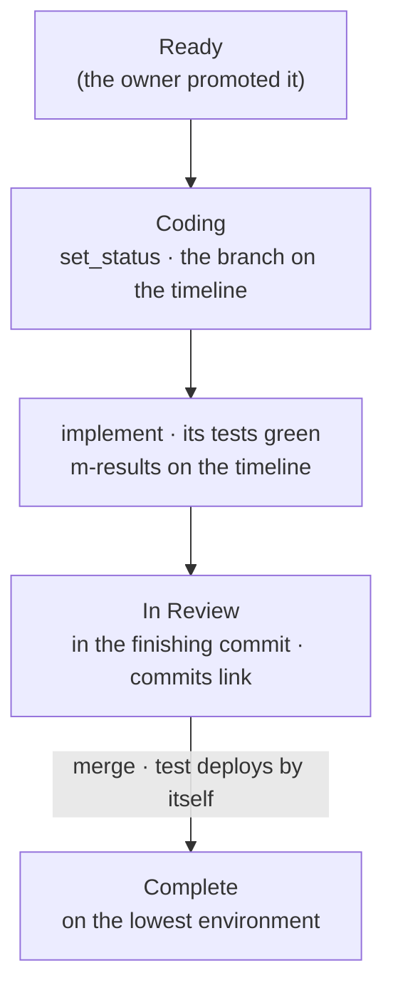

<m-summary>

<m-answer data-field="answer">**Claim it, build it in its own worktree, show the gate on the ticket, link the commits in the step that flips it to In Review, and let the pipeline land it.**</m-answer>

<m-stat value="2">finish lines: In Review is the builder's, Complete is the work's</m-stat>
<m-stat value="1">worktree per ticket</m-stat>

</m-summary>

<m-diagram data-field="shape" label="The loop">



Merging is not deploying. Where the project has environments, a ticket is Complete when its work runs on the lowest one, the deploy to test that carries it (owner, 2026-10-17: "complete, if there is an environment, should mean that it's deployed to the lowest environment"; DEPLOY-22). Until then it stays In Review with its merge linked. It reaches users when its release is promoted. Work in a repository with no environment is Complete at its merge.

</m-diagram>

<m-walk kicker="One build, claimed to landed" heading="What the builder does, and writes on the ticket.">

### Read the ticket as the two strangers would.

Can you build it from the body alone? If not, it is a ticketing failure: patch the ticket (`evidence`, the options), return it to Pending, stop.

### Claim it: Coding the moment work starts.

<m-code lang="markdown" why="the branch on the timeline; set_status Coding in the same move">

```markdown
<m-status data-field="status">

<m-step date="2026-10-13T09:12Z" status="Coding" by="builder">Branch `volt/AMP-4-queue`, worktree `volt-AMP-4`.</m-step>

</m-status>
```

</m-code>

A step's `date` is the moment, in UTC: `date -u +%FT%RZ` writes it (`2026-10-13T09:12Z`). The timeline shows each step's time where the reader is and says the day once, where it changes, as a chat does (ART-12); a date alone still draws, with no time.

A worktree and branch named for the ticket, so no leaf is double-claimed and attribution falls out of the names. Triage the tree first: a dirty file belongs to some body of work — this ticket's, another's, or unknown (stop and ask). Never build on it silently.

A worktree shares one build directory with every other worktree of its repository (owner, 2026-10-15): `export CARGO_TARGET_DIR=~/.cache/cargo-target/<repo>` before the first `cargo` in it — `menger` for menger and its frontend — so a worktree costs megabytes, not the 20 GB its own `target/` would, and the next ticket's build is warm. Cargo serialises two builds in one directory with its lock. The pipeline's `../menger-build` keeps its own.

### Implement; its own tests green — a selection, not the suite.

Per ticket, run the tests the change adds and the nearest ones it touches — a best-effort selection (`cargo test -p <crate> <filter>`, the one wire test, the frontend's file), never the whole workspace (owner, 2026-10-18: "when performing updates I only want you running the new tests, then we should queue up a bunch of changes all at once, and only then run all tests against everything"; CI-3). The affected crate still builds. A pre-existing red in the selection keeps the ticket `Coding` and files a gap that blocks it.

Changes queue up merged; the full suite runs once against the batch, before deploying — in menger, `deploy/pipeline build` gates every release on the whole workspace and the frontend tests. A red there is the batch's: find the commit (the failing test's area, else bisect the batch), file a gap that blocks its ticket, fix or revert, and build again.

### Show the gate; flip in the finishing commit.

<m-code lang="bash" why="the commit message ends “— in review”; the same step links the commits and sets the status">

```bash
synapse -P 4455 menger tickets commits link --id AMP-4 --commits 77df9a0 --commits volt@1a2b3c4
synapse -P 4455 menger tickets set_status --id AMP-4 --status "In Review"
```

</m-code>

<m-code lang="markdown" why="the In Review step: commits as chips, the gate as tiles">

```markdown
<m-step date="2026-10-14T16:40Z" status="In Review" commits="volt@77df9a0" by="builder">

Its tests green (a selection; the suite runs at the batch's build).

<m-results label="Selected — volt">

| suite | passed | failed | verdict |
| -- | -- | -- | -- |
| volt-api | 41 | 0 | |
| app | 12 | 0 | |

</m-results>

</m-step>
```

</m-code>

### The pipeline lands it; clean up in the same pass.

In menger's own case, **a ticket entering In Review is deployed to test automatically; prod is the owner's** (owner, 2026-10-19: "we always instantly deploy everything to test. we tolerate rollback"; DEPLOY-48). The deploy runner watches the tracker and, a quiet minute after a ticket enters In Review or a commit is linked to one there, deploys main's tip to test — one run at a time, a burst of merges folded into one. So: merge `--no-ff` (never squash or rebase: the branch's commits are how "is it on test" is answered), link the merge commit, leave the ticket In Review — and run no deploy yourself. The deploy to test completes it; a red one is posted to the ticket's chat with a gap blocking it. The worktree goes in the same pass as the merge, never later (owner, 2026-10-15: 79 of them had gathered, 700 GB) — and say which release when it matters.

<m-code lang="bash" why="the one way to remove what a gate left: a dry run unless --yes, and it logs what it removes">

```bash
../menger/scripts/cleanup-gate.sh <name>                                # what the gate <name> left, and the space it holds
../menger/scripts/cleanup-gate.sh --yes <name>                          # its worktree + merged branch, the worktree's cargo build-dirs, ~/.cache/cargo-target/<name>, /tmp/menger-<name>.db*, its session scratch
../menger/scripts/cleanup-gate.sh --yes --path /tmp/claude-1000/<dir>   # one leftover, by its shape
../menger/scripts/cleanup-gate.sh --list                                # every leftover it recognises; removes nothing
```

</m-code>

An agent never hand-writes `rm -r` / `rm -rf` (owner, 2026-10-16: "we need to make sure to not hit spooky rms"; RUN-21). The script removes only the known shapes — a linked worktree through `git worktree remove` (never forced) with its cargo build-dirs (`~/.cache/cargo-build/XX/HASH`, as `cargo metadata` names them), its branch through `git branch -d`, a cargo target that is not a shared one, a throwaway server's `/tmp/menger-*.db*`, a session's scratch, `/tmp/theme-sweep` — with symlinks resolved, and refuses `/`, `$HOME`, a main checkout, `~/.local/share/menger`, a dirty worktree, anything in use (a cargo holding its lock too) and any path with `..`. A refusal is the answer: leave the path and say so on the ticket, never reach for `rm`.

Builds clean up after themselves too (owner, 2026-10-18: "our test runner automatically cleans up their builds"; CI-2): the hourly `menger-sweep.timer` runs `cleanup-gate.sh --sweep --yes`, which removes build output nothing has touched for 6 hours (1 hour once the disk is 75% used, 15 minutes at 90%) and nothing holds, and queues the owner a ticket when the disk is still 90% full. Before a long gate, `../menger/scripts/disk-check.sh` says whether there is room (exit 3: there isn't — sweep or ask, don't start).

</m-walk>

<m-field data-field="decided-shape" label="When the build is a frontend">

**Every ticket that changes the frontend has a mockup before and screenshots after** (owner, 2026-10-22: "for any ticket that updates the fe I want screenshots after and a mockup before"). Before Coding, the body holds a mockup of the page as it will be (`showing`), and if the ticket has none, the builder draws it first. At In Review, the step holds screenshots of the built page from test or a throwaway server (`scripts/shot.mjs`), at 390 and 1440, light and dark. Once APP-110 lands, a `live` block of the route on test goes beside the mockup.

The owner will look at the ticket, not the branch. So the In Review step shows the thing: the component block in the body updated to the built source (its docs card re-renders in place); or the page as a mockup at its widths; or screenshots from the test environment (`scripts/shot.mjs '#/…' --env test --theme both --width 1440,400`) in the step, with a line on what they cannot show. A theme change runs the sweep (`scripts/theme-sweep.mjs`) on a throwaway server. The house's own bodies pass `MENGER_HOUSE_BODIES` before they are filed.

</m-field>

<m-field data-field="detail" label="Divergence">

When reality differed from the design — a call site the ticket did not foresee, a contract loosened — append a dated card under `intended-usage`'s `m-divergence-notes`; never edit an earlier one. A divergence that changes what downstream reads is out of contract: stop, patch the ticket, back to Pending.

</m-field>

<m-cases label="Rules">

| rule | why |
| -- | -- |
| no work on a Draft or Pending ticket — tickets are born Draft | Ready is the owner's word |
| no manual deploys: entering In Review deploys test; prod is the owner's | the owner tolerates a rollback on test, never a pile of unshipped review (DEPLOY-48) |
| Coding the moment work starts; In Review in the commit that finishes it | the tracker shows where the work is |
| one worktree per ticket, named for it | no work outside its ticket goes in its commits |
| its selected tests before In Review, shown on the ticket; the full suite once per batch, before deploying | a ticket moves fast; nothing ships without every test run against everything queued (CI-3) |
| every commit linked, `repo@hash` outside the ticket's repository | the diff is one click from the ticket |
| a contract that can't be built is patched, not worked around | a silent workaround ships an unannounced change every consumer reads as correct |
| clean up with `scripts/cleanup-gate.sh`, never a hand-written `rm -r` | a removal the script refuses is one nobody should make blind |
| a gate starts only with room (`scripts/disk-check.sh`) | the disk filled twice with build output (CI-2); a gate that dies half-way proves nothing |
| archive before you delete | un-shipped work is tagged `archive/<name>` and pushed before removal; the ticket is Superseded with the tag, the removal commit and the survivor named |

</m-cases>

<m-field data-field="detail" label="The timeline, as a build keeps it">

The build example's `acceptance`, the list the gate is held to: [../ticketing/examples/build.md](../ticketing/examples/build.md).

</m-field>

<m-field data-field="execution">The build's form: <a href="../ticketing/build.md">the build — what does it do, and how do I call it?</a>. Screenshots and the frontend rule: <a href="../showing/SKILL.md">showing — the picture is the body</a>. The calls: <a href="../reaching/SKILL.md">reaching — the synapse calls against menger</a>. menger's own pipeline: `../menger/deploy/README.md`.</m-field>
