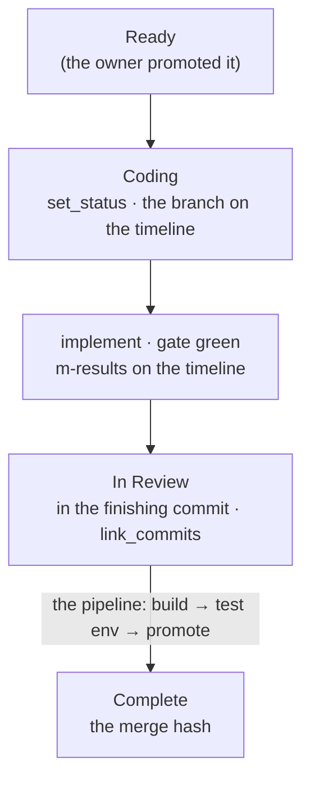

<m-summary ticket="SKILL-12">

<m-answer data-field="answer">**Claim it, build it in its own worktree, show the gate on the ticket, link the commits in the step that flips it to In Review, and let the pipeline land it.**</m-answer>

<m-stat value="2">finish lines: In Review is the builder's, Complete is the work's</m-stat>
<m-stat value="1">worktree per ticket</m-stat>

</m-summary>

<m-diagram data-field="shape" label="The loop">



Merging is not deploying: a ticket is Complete at the merge and reaches users when its release is promoted.

</m-diagram>

<m-walk kicker="One build, claimed to landed" heading="What the builder does, and writes on the ticket.">

### Read the ticket as the two strangers would.

Can you build it from the body alone? If not, it is a ticketing failure: patch the ticket (`evidence`, the options), return it to Pending, stop.

### Claim it: Coding the moment work starts.

<m-code lang="markdown" why="the branch on the timeline; set_status Coding in the same move">

```markdown
<m-status data-field="status">

<m-step date="2026-10-13" status="Coding" by="builder">Branch `volt/VOLT-4-queue`, worktree `volt-VOLT-4`.</m-step>

</m-status>
```

</m-code>

A worktree and branch named for the ticket, so no leaf is double-claimed and attribution falls out of the names. Triage the tree first: a dirty file belongs to some body of work — this ticket's, another's, or unknown (stop and ask). Never build on it silently.

A worktree shares one build directory with every other worktree of its repository (MENGER-41, owner 2026-10-15): `export CARGO_TARGET_DIR=~/.cache/cargo-target/<repo>` before the first `cargo` in it — `menger` for menger and its frontend — so a worktree costs megabytes, not the 20 GB its own `target/` would, and the next ticket's build is warm. Cargo serialises two builds in one directory with its lock. The pipeline's `../menger-build` keeps its own.

### Implement; gate green in this workspace.

The affected workspace builds and tests pass — every acceptance list includes it. A pre-existing red keeps the ticket `Coding` and files a gap that blocks it.

### Show the gate; flip in the finishing commit.

<m-code lang="bash" why="the commit message ends “— in review”; the same step links the commits and sets the status">

```bash
synapse -P 4455 menger tickets link_commits --id VOLT-4 --commits 77df9a0 --commits volt@1a2b3c4
synapse -P 4455 menger tickets set_status --id VOLT-4 --status "In Review"
```

</m-code>

<m-code lang="markdown" why="the In Review step: commits as chips, the gate as tiles">

```markdown
<m-step date="2026-10-14" status="In Review" commits="volt@77df9a0" by="builder">

Gate green.

<m-results label="Gate — volt">

| suite | passed | failed | verdict |
| -- | -- | -- | -- |
| volt-api | 41 | 0 | |
| app | 12 | 0 | |

</m-results>

</m-step>
```

</m-code>

### The pipeline lands it; clean up in the same pass.

In menger's own case, `deploy/pipeline build → deploy test → promote`. The worktree goes when the work lands — in the same pass as the merge, `git worktree remove ../<repo>-<TICKET> && git branch -d <branch>`, never later (MENGER-41: 79 of them had gathered, 700 GB) — and say which release when it matters.

</m-walk>

<m-field data-field="decided-shape" label="When the build is a frontend">

The owner will look at the ticket, not the branch. So the In Review step shows the thing: the component block in the body updated to the built source (its docs card re-renders in place); or the page as a mockup at its widths; or screenshots from the test environment (`scripts/shot.mjs '#/…' --env test --theme both --width 1440,400`) in the step, with a line on what they cannot show. A theme change runs the sweep (`scripts/theme-sweep.mjs`) on a throwaway server. The house's own bodies pass `MENGER_HOUSE_BODIES` before they are filed.

</m-field>

<m-field data-field="detail" label="Divergence">

When reality differed from the design — a call site the ticket did not foresee, a contract loosened — append a dated card under `intended-usage`'s `m-divergence-notes`; never edit an earlier one. A divergence that changes what downstream reads is out of contract: stop, patch the ticket, back to Pending.

</m-field>

<m-cases label="Rules">

| rule | why |
| -- | -- |
| no work on a Pending ticket | Ready is the owner's word |
| Coding the moment work starts; In Review in the commit that finishes it | the tracker shows where the work is |
| one worktree per ticket, named for it | no work outside its ticket goes in its commits |
| the gate before In Review, shown on the ticket | downstream conditions on In Review meaning shippable |
| every commit linked, `repo@hash` outside the ticket's repository | the diff is one click from the ticket |
| a contract that can't be built is patched, not worked around | a silent workaround ships an unannounced change every consumer reads as correct |
| archive before you delete | un-shipped work is tagged `archive/<name>` and pushed before removal; the ticket is Superseded with the tag, the removal commit and the survivor named |

</m-cases>

<m-field data-field="detail" label="The timeline, as a build keeps it">

<m-cite ref="VOLT-4" field="acceptance"></m-cite>

</m-field>

<m-field data-field="execution">The build's form: <m-ticket ref="SKILL-6" full></m-ticket>. Screenshots and the frontend rule: <m-ticket ref="SKILL-13" full></m-ticket>. The calls: <m-ticket ref="SKILL-17" full></m-ticket>. menger's own pipeline: `../menger/deploy/README.md`.</m-field>
