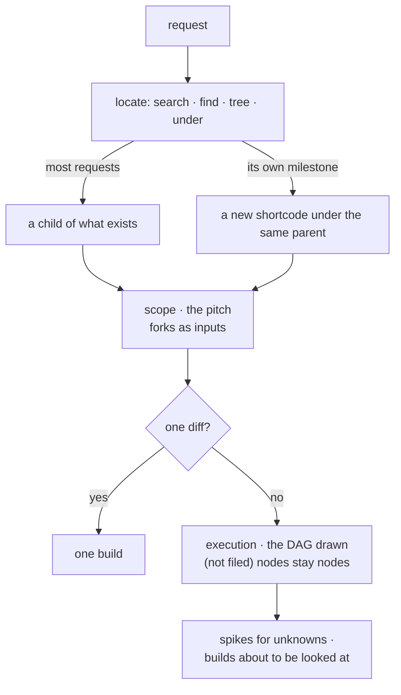

<m-summary ticket="SKILL-10">

<m-answer data-field="answer">**Find where the request lives, write the scope so the owner can place the bet from its first screen, draw the whole route on the execution, and file a leaf only when someone is about to look at it.**</m-answer>

<m-stat value="3">roots, fixed: MENGER · PLEXUS · OUGHT</m-stat>
<m-stat value="2">tickets per milestone: a scope and an execution</m-stat>

</m-summary>

<m-diagram data-field="shape" label="The moves">



Placement first, scope second, the fork third; the leaves last, and only the live ones.

</m-diagram>

<m-walk kicker="The process" heading="Eight moves, in order.">

### Locate it — a new request is not a new root.

<m-code lang="bash" why="read the hits' subtrees before writing anything">

```bash
synapse -P 4455 menger tickets search --query 'charger stream' --filter 'not category done'
synapse -P 4455 menger tickets find --query queue
synapse -P 4455 menger tickets list --filter 'under MENGER-4 and kind scope' --summary true
synapse -P 4455 menger tickets tree --epic VOLT --filter 'not category done'
synapse -P 4455 menger tickets counts --filter 'ready and under PLEXUS-1'
```

</m-code>

Most requests advance a scope that exists and become a child of it. A request that is its own milestone becomes a new shortcode **under** the parent its closest relative has — the three roots are fixed, and a shortcode's root is created with `--parent` set to where it belongs. Brownfield material — a heap of found documents — enters as a research spike that cites them and gives rise to the scope.

### Write the scope as a pitch.

<m-ticket ref="SKILL-4"></m-ticket>: the epitome, the end state as one diagram, the decided shape in fat marker, the language, the edges, the interface contract — and **the fork as an input** (`m-decision id=`), so the owner's first look is also where they place the bet. Iterate the body in place until the four tests pass (the language resolves, the edges are drawn, the contract is stateable, an execution can be written from it). Then stop.

### One diff, or a DAG?

Can one agent make it in one diff from the ticket alone? Yes: one build under the scope, and planning is over. No: an execution.

### Draw the whole route; file only what is live.

<m-ticket ref="SKILL-5"></m-ticket>: the DAG in `m-dag`, every node drawn — spikes, decision gates, builds, gaps found, the completion gate — and a node not yet worth a look labelled *(not filed)*. File a **spike** for every load-bearing fact nobody has pinned (an unpinned fact is a latent spike; a `low`-confidence build is blocked by one); the **builds at the roots** — the shared contracts siblings consume, extracted first so no two re-mint them; and the builds the owner will look at **this cycle**. The rest stays drawn. When a root lands, the next tranche is filed in the same pass that updates the DAG.

### Contracts on the edges.

Every build's `provides` and `consumes` are tables; every consumed input names the ticket that produces it. Diff every consumes against every provides: a consume with no producer is a missing root; a structure two tickets provide is a duplicate owner. Both are found at plan time on the page, not at merge.

### Blockers as edges; status derived.

`--blocked-by A,B` at create, or `update --id X --block Y` later. `Blocked` is derived by the tracker; nobody sets it. The ready set is `ready_set --filter 'kind build and under VOLT-1'`.

### The parent is built from the children.

The scope cites the execution's `dag` and each build's `problem` or `intended-usage` (`m-cite`); the execution's walk shows the code each child owns. A reader descends from the scope without leaving it; nothing is described twice.

### Everything Pending.

<m-code lang="bash" why="the owner promotes; the agent never does">

```bash
synapse -P 4455 menger tickets create --epic VOLT --title "Volt — nine flats, two chargers" --kind scope --parent WRAP-9 --body "$(cat scope.md)"
synapse -P 4455 menger tickets create --epic VOLT --title "One evening, end to end" --kind execution --body "$(cat execution.md)"
synapse -P 4455 menger tickets create --epic VOLT --title "Spike: stream or poll?" --kind spike --parent VOLT-2 --body "$(cat spike.md)"
synapse -P 4455 menger tickets create --epic VOLT --title "volt.queue" --kind build --parent VOLT-2 --blocked-by VOLT-3 --body "$(cat build.md)"
```

</m-code>

Then screenshot each ticket and read it as the owner will.

</m-walk>

<m-field data-field="decided-shape" label="Rules">

- **Locate before you create.** Placement first; scope second.
- **One scope, one execution per milestone.** The scope holds the why and the forks; the execution holds the DAG and the children; neither holds the other's.
- **A ticket is filed when it is about to be looked at.** Until then it is a node on the parent's DAG, marked *(not filed)*.
- **Shared contracts are early roots.** Type-first at the leaf; API- or capability-first above.
- **An unknown is a spike, not an assumption.** A spike's result is a metric sheet whose command is the build's gate.
- **A fork is an input on the scope**, never a paragraph of options in a build.
- **Cite, don't copy.** The children are windows in the parent.
- **The DAG never lags the children.** A build added, removed, promoted or re-sequenced is drawn on the execution in the same write.
- **Human ratifies at the forks.** New tickets, promotions, archivals, milestone boundaries are the owner's; the agent sweeps the mechanics.

</m-field>

<m-cases label="When the plan changes">

| when | then |
| -- | -- |
| a build outgrows itself | it was an execution in disguise: `set_kind --id X --kind execution`, file its children under it, draw its DAG, keep it as one node on the parent's — the size test firing on contact, not a failure |
| work is dropped | `set_status … Superseded` or `Canceled` with `--message` naming the survivor; the parent's DAG collapses in the same write; the survivor's `evidence` says what it subsumed |
| a row was a mistake, a duplicate, a test | `delete` — never for work that was real |

</m-cases>

<m-field data-field="detail" label="Fewer, drawn whole — as VOLT-2 does it">

Seven nodes drawn, four filed: the spike that unlocks everything, the build at the root, the build the owner will play with this week, and the gap that was found. `volt.chargers` and `the app` are drawn *(not filed)*; they are filed when VOLT-4 lands. The opposite — nine builds filed on day one, each a paragraph, the owner asked to promote all nine — ends with the scope skimmed, builds 6 to 9 never opened, and three superseded before anyone read them.

<m-cite ref="VOLT-2" field="dag"></m-cite>

</m-field>

<m-field data-field="execution">The forms: <m-ticket ref="SKILL-3" full></m-ticket>. Inputs: <m-ticket ref="SKILL-11" full></m-ticket>. The calls: <m-ticket ref="SKILL-17" full></m-ticket>.</m-field>
