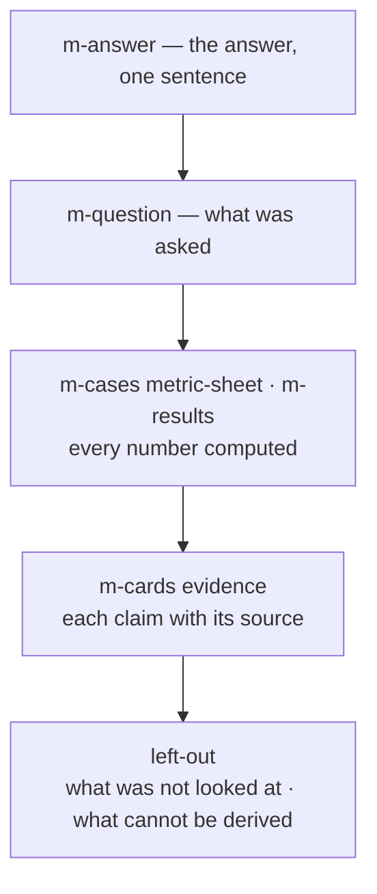

<m-summary>

<m-answer data-field="answer">**When the reader is not going to open the source, the report is the artifact — so it gives the answer in one sentence, every number computed, every claim anchored, and nothing silently absent.**</m-answer>

<m-stat value="5">states an item can be in</m-stat>
<m-stat value="BLIND">the one a reader mistakes for a finding</m-stat>

</m-summary>

<m-field data-field="context" label="When this applies">The owner reads the doc for what exists. Use it for a spike's report, a survey, a status, a close-out, a manifest, a model check. Not for an argument or a decision that needs reasons — that is prose on the ticket that holds the decision, with the evidence as a report beneath it.</m-field>

<m-diagram data-field="shape" label="The form">



Answer, question, numbers, sources, and what is missing — in that order, so a reader who stops early still has the result.

</m-diagram>

<m-field data-field="detail" label="Skeleton">

`````markdown
<m-summary ticket="AMP-9">

<m-answer data-field="answer">No production path closes a session on a new boot_id; two of fourteen simulated nights left a ghost session.</m-answer>

<m-stat value="2 / 14" tone="fail">nights with a ghost</m-stat>
<m-stat value="3" tone="info">call sites read</m-stat>

</m-summary>

<m-question data-field="question">Does anything close a session when its charger's stream reopens?</m-question>

<m-cases data-field="metric-sheet">

| metric | current | target | command |
| -- | -- | -- | -- |
| sessions outliving their stream, 14 nights | 2 | 0 | `spike/ghosts.sh` |

</m-cases>

<m-results label="Gate — volt, as found">

| suite | passed | failed | verdict |
| -- | -- | -- | -- |
| volt-api | 41 | 0 | |
| soak | | | needs the simulator |

</m-results>

<m-cards data-field="evidence">
<m-card headline="Three writers of session state" note="volt/src/chargers.rs:88, sessions.rs:41, 210" fold>All three go through `Sessions::stop`; none is called on stream open.</m-card>
<m-card headline="The simulator reboots nightly" note="spike/sim.toml" tone="muted" fold>`reboot = "02:10"`; a real charger's reboot cadence is unknown.</m-card>
</m-cards>

<m-field data-field="left-out">

- A real charger's reboot cadence: not measured — the simulator's is a guess.
- Billing: not read; `volt.invoices` was out of the ceiling.
- The proposed `Query` command: the vendor's schema has it; whether firmware answers it is **BLIND** — the simulator always answers.

</m-field>
`````

</m-field>

<m-cases label="The five states — collapsing two is the failure this form exists to prevent">

| state | meaning |
| -- | -- |
| confirmed | someone asserted it, and it holds |
| proposed | derived; asserted by nobody — the default |
| hole | declared, and nothing found it — the work queue |
| orphan | found, and nobody declared it |
| BLIND | could not look — never rendered as empty, absent or zero |

</m-cases>

`m-cases` draws a column headed `state` as pills; `BLIND` is written in capitals because it is the one a reader will otherwise mistake for a finding.

<m-field data-field="decided-shape" label="Rules">

1. **Answer first.** The `m-answer` is the summary's lead; a reader who stops there has the result.
2. **Every number is computed**, and says how (the command column, the suite row). A number typed from memory does not belong.
3. **Every claim names its source** — a card's note is the anchor (a path and lines, a ticket id, a command) that lets someone re-find it.
4. **Print what you cannot derive.** The `left-out` field names the question and how far derivation got. Omission teaches the reader to trust you about things you never checked.
5. **Keep rejected guesses** — *heuristic proposed X · inspection rejected it · why* — so the next pass does not re-derive them.
6. **Say what would change it.** The commands that re-measure; the spike that would close a BLIND.
7. **File it where it came from.** A child doc of the spike, the execution, the survey's scope. Not a file in the repository.

</m-field>

<m-cases label="Status, periodically — and calibration, at close">

| when | write |
| -- | -- |
| anything that runs for weeks | a dated step on the execution's timeline answering: where are we; how is the direction captured, findable cold; what was discussed but not persisted — the third is the load-bearing one; its gaps become tickets, inputs or body patches in the same pass |
| the last build's change is open | a one-line takeaway at the bottom of the execution: which `low` tickets needed revision (correctly low), which passed first try (over-hedged), which `high` ones needed revision (under-hedged), the most expensive surprise and whether any upstream evidence hinted at it |

</m-cases>

<m-field data-field="detail" label="Answers first — as the report example does it">

The ghost-session report, [examples/report.md](examples/report.md) (`shots/report.png`), opens with what was found in one sentence, then the question, the metric sheet with its command, the gate as found, each claim with its source, and what was left unlooked at — the skeleton above, filled. The opposite — *we looked into the session issue and it seems fine in most cases* — has no number, no source, no left-out; a reader cannot say what was checked.

</m-field>

<m-field data-field="execution">The doc's form: <a href="../ticketing/doc.md">the doc — what is so, and why?</a>. Results tiles and metric sheets: <a href="../surface/SKILL.md">surface — what a body on menger can show, ask, cite and wear</a>.</m-field>
