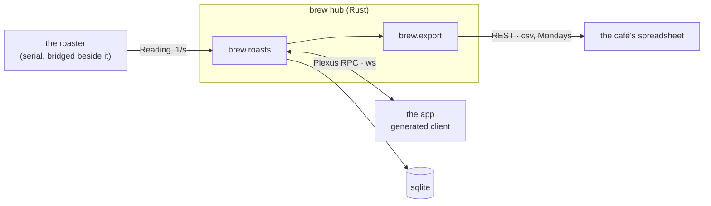

<m-summary ticket="ROAST-1">

<m-field data-field="standing">**Every roast is a curve the roaster streams, the app watches and the café reads as a CSV — and first crack is never missed again.**</m-field>

<m-stat value="1 / 3" tone="pass">done</m-stat>
<m-stat value="1" tone="fail">gap open</m-stat>
<m-stat value="3">wires</m-stat>

</m-summary>

<m-field data-field="status" label="The feed">

<brew-feed epic="ROAST"></brew-feed>

</m-field>

<m-beat data-field="problem" kicker="brew" size="lead">

9:38. The drum is at 196 °C and climbing. You're listening for first crack with the window open, because the roaster's display is a number and your ears are the only log.

**The roaster knows the curve. Nobody writes it down.**

<svg slot="figure" viewBox="0 0 220 150" role="img" aria-label="a roast curve climbing to first crack"><path d="M20 130 H200" style="stroke:var(--line);stroke-width:2"></path><path d="M20 128 C70 125 100 90 130 62 C150 44 170 36 200 30" style="fill:none;stroke:var(--accent);stroke-width:4;stroke-linecap:round"></path><circle cx="130" cy="62" r="6" style="fill:var(--accent)"></circle><text x="130" y="50" text-anchor="middle" style="font:700 11px var(--mono);fill:var(--ink)">first crack</text><text x="40" y="145" style="font:500 10px var(--mono);fill:var(--muted)">9:30</text><text x="190" y="145" text-anchor="end" style="font:500 10px var(--mono);fill:var(--muted)">9:42</text></svg>

</m-beat>

<m-diagram data-field="end-state">



The roaster's serial line is wrapped once in an RPC bridge on a small box beside it; the hub never sees a serial port. The app holds one stream open per roast; the café pulls last week as CSV on Monday.

</m-diagram>

<m-field data-field="decided-shape">

1. **One roast is one stream.** `brew.roasts.watch { roast }` replays the curve so far, then live.
2. **Events are heard, not detected.** The roaster reports first crack when the probe's rate of rise drops; the hub trusts it and records the second — which is where <m-ticket ref="ROAST-4"></m-ticket> comes from.
3. **The café gets a file.** No login, no dashboard: `GET /rest/brew/export/week?w=2026-W41`, CSV.

</m-field>

<m-beat center>

9:41. The drum hit 230 °C. First crack was logged at 9:41:07.

Then the probe went quiet.

</m-beat>

<m-field data-field="execution"><m-ticket ref="ROAST-2" full></m-ticket> is one roast, bean to CSV. What happened at 9:41 is <m-ticket ref="ROAST-4" full></m-ticket>. The look is <m-ticket ref="ROAST-6" full></m-ticket>.</m-field>

```component brew-feed epic=ROAST
<template>
<header class="top" part="top">
<span class="streak" part="streak"></span>
<span class="loop" part="loop"></span>
<span class="live" part="live" hidden>live</span>
</header>
<div class="cards" part="cards"></div>
<button class="more" part="more" hidden>more</button>
<p class="end" part="end" hidden></p>
</template>
<style>
:host{display:block}
.top{display:flex;flex-wrap:wrap;gap:.6rem 1.4rem;align-items:center;margin:0 0 .8rem;font:var(--weight-medium) calc(12.5px * var(--text-scale)) var(--sans);color:var(--muted)}
.streak b,.loop b{font:var(--weight-bold) calc(24px * var(--text-scale)) var(--font-display);color:var(--ink);margin-right:.3rem;letter-spacing:-.02em}
.live{margin-left:auto;font:var(--weight-strong) calc(11px * var(--text-scale)) var(--mono);letter-spacing:.1em;text-transform:uppercase;color:var(--accent);display:inline-flex;align-items:center;gap:.4rem}
.live::before{content:'';width:8px;height:8px;border-radius:50%;background:var(--accent);animation:pulse 1.2s ease-out infinite}
@keyframes pulse{0%{box-shadow:0 0 0 0 color-mix(in srgb,var(--accent) 60%,transparent)}100%{box-shadow:0 0 0 10px transparent}}
.cards{display:grid;gap:.7rem}
.card{position:relative;display:grid;gap:.35rem;padding:.9rem 1rem 1rem;border:var(--border) solid var(--line);border-radius:var(--radius-xl);background:var(--card);cursor:pointer;transition:transform var(--motion-fast) var(--ease),border-color var(--motion-fast) var(--ease)}
.card:hover{transform:translateY(-1px);border-color:var(--accent)}
.card.new{border-color:var(--accent)}
.card.flash{animation:flash var(--motion-flash) var(--ease)}
@keyframes flash{0%{background:color-mix(in srgb,var(--accent) 18%,var(--card))}100%{background:var(--card)}}
.meta{display:flex;flex-wrap:wrap;gap:.4rem .7rem;align-items:center;font:calc(11.5px * var(--text-scale)) var(--mono);color:var(--muted)}
.id{font-weight:var(--weight-strong);color:var(--accent)}
.st{padding:0 .5rem;border-radius:var(--radius-pill);border:var(--border) solid var(--chip-line);background:var(--chip-bg);color:var(--chip-fg)}
.when{margin-left:auto}
.dot{position:absolute;top:.95rem;right:1rem;width:9px;height:9px;border-radius:50%;background:var(--accent)}
.title{font:var(--weight-strong) calc(17px * var(--text-scale))/1.3 var(--font-display);color:var(--ink);letter-spacing:-.01em;padding-right:1.2rem}
.more{margin:.8rem auto 0;display:block;font:var(--weight-strong) calc(13px * var(--text-scale)) var(--sans);color:var(--bg);background:var(--accent);border:0;border-radius:var(--radius-pill);padding:.45rem 1.3rem;cursor:pointer}
.end{margin:.8rem 0 0;text-align:center;font:calc(12.5px * var(--text-scale)) var(--sans);color:var(--muted)}
[hidden]{display:none !important}
@media (prefers-reduced-motion:reduce){.live::before,.card.flash{animation:none}}
</style>
<docs>
  <summary>The feed: a shortcode's tickets as cards, newest change first, three at a time and more as you ask; a dot on what changed since you last saw it, a streak of the days you came back, how many are left, and a pulse while the tracker is moving. Every number is the tracker's; the streak and the seen-marks are this browser's.</summary>
  <attr name="epic" type="string">The shortcode to feed (default ROAST).</attr>
  <attr name="page" type="number">Cards shown before "more" (default 3).</attr>
  <part name="top">The streak, the open loop and the pulse.</part>
  <part name="streak">Days in a row this feed was opened.</part>
  <part name="loop">Done of total, and what is left.</part>
  <part name="live">The pulse, for a minute after a change arrives.</part>
  <part name="cards">The cards.</part>
  <part name="more">The next-up button.</part>
  <part name="end">The line at the end: there is an end.</part>
  <example><brew-feed epic="ROAST"></brew-feed></example>
  The mechanics are the feed's — recency, unread, a streak, an open loop, next-up, a pulse — with true numbers and an end: nothing here is made up, nothing is infinite, and nothing is recorded anywhere but this browser.
</docs>
<script>
const epic = (this.attr('epic') || 'ROAST').toUpperCase(), PAGE = +(this.attr('page') || 3), me = this.menger.input && this.menger.input.ticket;
const $ = (q) => this.root.querySelector(q), cards = $('.cards'), more = $('.more'), end = $('.end'), live = $('.live');
const store = { get(k, d) { try { return JSON.parse(localStorage.getItem(k)) ?? d; } catch { return d; } }, set(k, v) { try { localStorage.setItem(k, JSON.stringify(v)); } catch {} } };
// the streak: days in a row this browser opened the feed
const today = new Date().toISOString().slice(0, 10), days = store.get('brew.days', []);
if (!days.includes(today)) { days.push(today); store.set('brew.days', days.slice(-60)); }
let streak = 0; for (let d = new Date(today); days.includes(d.toISOString().slice(0, 10)); d.setDate(d.getDate() - 1)) streak++;
$('.streak').innerHTML = `<b>${streak}</b>${streak === 1 ? 'day — come back tomorrow' : 'days in a row'}`;
const seen = store.get('brew.seen', {}), ago = (u) => { const s = Date.now() / 1000 - u; return s < 90 ? 'just now' : s < 3600 ? `${Math.round(s / 60)} min ago` : s < 86400 ? `${Math.round(s / 3600)} h ago` : `${Math.round(s / 86400)} d ago`; };
let rows = [], shown = PAGE, pulse = 0;
const draw = () => {
  const list = rows.filter((r) => r.id !== me).sort((a, b) => b.updated_unix - a.updated_unix);
  cards.innerHTML = '';
  list.slice(0, shown).forEach((r) => {
    const unread = (seen[r.id] || 0) < r.updated_unix, el = document.createElement('article');
    el.className = 'card' + (unread ? ' new' : ''); el.dataset.id = r.id;
    el.innerHTML = `<div class="meta"><span class="id">${r.id}</span><span>${r.kind}</span><span class="st">${r.status}</span><span class="when">${ago(r.updated_unix)}</span></div><div class="title">${r.title}</div>${unread ? '<i class="dot" title="changed since you last saw it"></i>' : ''}`;
    el.onclick = () => this.menger.navigate('#/ticket/' + r.id);
    cards.append(el);
  });
  more.hidden = shown >= list.length; end.hidden = shown < list.length;
  end.textContent = `that's all — ${list.length} of ${list.length}. There is an end.`;
  const work = rows.filter((r) => ['build', 'spike', 'gap'].includes(r.kind)), done = work.filter((r) => r.status === 'Complete').length, left = work.length - done;
  $('.loop').innerHTML = `<b>${done}</b>of ${work.length} done${left ? ` — ${left === 1 ? 'one' : left} left` : ' — nothing left'}`;
};
// a card is "seen" once it has sat in view for a second
const io = 'IntersectionObserver' in window ? new IntersectionObserver((es) => es.forEach((e) => {
  if (!e.isIntersecting) return;
  const id = e.target.dataset.id, r = rows.find((x) => x.id === id);
  setTimeout(() => { if (!r) return; seen[id] = r.updated_unix; store.set('brew.seen', seen); e.target.classList.remove('new'); const dot = e.target.querySelector('.dot'); if (dot) dot.remove(); }, 1000);
}), { threshold: .6 }) : null;
const observe = () => io && cards.querySelectorAll('.card.new').forEach((c) => io.observe(c));
more.onclick = () => { shown += PAGE; draw(); observe(); };
const load = () => this.menger.call('list', { epic, summary: true, limit: 200 }).then((items) => { rows = items.map((x) => x && (x.summary || x.ticket)).filter(Boolean); draw(); observe(); }, (e) => { end.hidden = false; end.textContent = 'the tracker did not answer: ' + ((e && e.message) || e); });
load();
const off = this.menger.on('change', (ev) => {
  const t = ev && ev.ticket; if (!t || !String(t.id).toUpperCase().startsWith(epic + '-')) return;
  live.hidden = false; clearTimeout(pulse); pulse = setTimeout(() => { live.hidden = true; }, 60000);
  load().then(() => { const c = cards.querySelector(`[data-id="${t.id}"]`); if (c) c.classList.add('flash'); });
});
return () => { off(); clearTimeout(pulse); if (io) io.disconnect(); };
</script>
```
