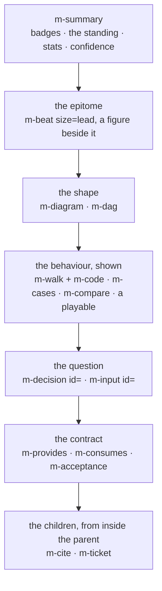

<m-summary ticket="SKILL-2">

<m-answer data-field="answer">**A ticket body is a page in a sandboxed frame that draws menger's house components, runs its own, follows the tracker live, asks the owner, cites other tickets and wears a theme — so a body that only has prose has used almost none of it.**</m-answer>

<m-stat value="36">house components</m-stat>
<m-stat value="50">field names</m-stat>

</m-summary>

<m-diagram data-field="shape" label="The page, top to bottom">



The order is the reader's arc (<m-ticket ref="SKILL-3"></m-ticket>); the components are below, by what they do. Every one has a docs card at `#/components/<name>`, and `synapse -P 4455 menger tickets components` answers all of them with their attributes, slots, parts and examples.

</m-diagram>

<m-cases label="The house components, by what they do">

| to … | write | notes |
| -- | -- | -- |
| open the ticket | `<m-summary ticket="ID">` holding an `<m-field data-field="standing">` (one bold sentence), `<m-stat value="…" tone="pass\|warn\|fail\|info\|muted">` tiles, an optional `<m-field data-field="confidence">` | `ticket=` adds the kind, live status and parent chip — write no badge the summary already draws |
| state one idea with a picture | `<m-beat kicker="…" size="lead" flip center>` — the claim, quieter lines, and an `<svg slot="figure">` | the first beat is the epitome; the figure uses `var(--accent)`, `var(--ink)`, never a literal colour |
| draw the shape | `<m-diagram data-field="end-state\|shape\|lens">` holding a mermaid fence and a caption line | menger draws it in the theme's palette and checks it on write (the `diagrams` service) |
| draw the plan | `<m-dag data-field="dag">` — the fence, then what each colour means | the DAG lives here, never behind a link |
| show one path through the code | `<m-walk kicker heading lit>` with `###` steps, each over an `<m-code path lang why>` fenced block | steps light as they scroll into view |
| pin behaviour | `<m-cases data-field="required-behavior\|problem\|interface-contract\|exit\|work\|metric-sheet" before= after=>` holding one table | ticket ids in cells become live chips; a `before`/`after` column is marked ✗/✓ |
| put two things side by side | `<m-compare labels="a\|b" data-field="core-transition">` holding two or more blocks | code, prose or lists |
| name the contract | `<m-provides data-field="provides">`, `<m-consumes data-field="consumes">` — Output · Shape · Consumed by / Input · Shape · Produced by | the header counts the rows |
| say what done is | `<m-acceptance data-field="acceptance">` — a numbered list, each item led by `[met]`, `[partly]`, `[unmet]`, `[n/a]` or nothing (open), evidence nested under it | tallied in the header |
| carry findings | `<m-cards data-field="evidence\|risks">` of `<m-card headline note date fold tone>` | a card folds its detail |
| keep a timeline | `<m-status data-field="status">` of `<m-step date status label commits by>` | oldest first; appended, never edited |
| show a gate | `<m-results label>` holding a suite · passed · failed · verdict table | tiles, pass/fail in colour and in words |
| ask the owner | `<m-decision data-field="decision" id="…" rows="a\|b\|c">` with `<m-question>`, `<m-option name value recommended cost benefit next>`, `<m-recommendation by>`; `<m-input id kind="multi\|text">` with `<m-choice value recommended>` | an `id` makes it live (<m-ticket ref="SKILL-11"></m-ticket>); without one it only displays |
| record an answer | `<m-answer data-field="answer" by date>DECIDED: …</m-answer>` in a decision; a doc's one-sentence answer in its summary | the banner hides the word DECIDED so it is not said twice |
| point at a ticket | `<m-ticket ref="ID" full>` | live status; `full` adds the title |
| zoom into a ticket | `<m-cite ref="ID" field="standing\|problem\|dag\|…">` or `<m-cite ref="ID#elementid">` | a live window, drawn by the host in the cited ticket's own frame and theme; inputs in it are display only; two deep at most |
| set something off | `<m-callout type="note\|warning\|risk" headline>`; `<m-details summary open>` | a callout is for what must not be missed; details fold what may be skipped |
| label a fact | `<m-badge status\|kind\|confidence\|severity\|tone>` | the word is always written |
| name a commit | `<m-commit ref="repo@hash">`, or a code span holding only `repo@hash` | drawn as a pill |
| show progress live | `<m-ring id>`, `<m-dial scope\|filter size>`, `<m-sponge scope\|filter depth size compact>` | read the tracker once per frame and follow `watch` |
| any other field | `<m-field data-field="…" label panel>` | the prose form |

</m-cases>

<m-field data-field="language" label="The field set — the agent's half of the body">

The names `data-field` accepts are menger's (`tickets-api/src/fields.rs`): `standing confidence shape problem context evidence required-behavior provides consumes intended-usage risks must-not-change acceptance completion status end-state language decided-shape core-transition open-questions interface-contract edges dependencies execution goal dag work decision-gates exit completion-gate landing calibration question lens setup pass-condition fail-consequence result disposition answer detail left-out consequences decision divergence-notes option recommendation metric-sheet`. A name outside the set is flagged on the page; `label=` changes what the reader sees without changing the name the agent reads.

</m-field>

<m-field data-field="detail" label="Writing the markup so it renders">

- **Tags on lines of their own; markdown between blank lines.** A blank line right after an opening tag starts markdown inside it; without one the content is raw HTML. A fence inside a tag has blank lines around it.
- **`<m-summary>` on several lines**, as in its docs: written on one line with a `<p>` inside, the parser ends it early.
- **A decision's parts each on a line of their own**, blank lines between them when they hold inline markdown.
- **An option's rows are attributes named after the row**, lowercased, other characters as hyphens: `rows="who waits|cost"` reads `who-waits` and `cost`.
- **No duplicate badges.** `m-summary ticket=` already draws the kind, the status and the parent.
- **An inline SVG figure** carries `role="img"` and `aria-label`, uses only `var(--…)` colours, and sits under the claim as `slot="figure"`.
- **The frontmatter is hidden.** menger splits a leading `---` block off and reads only `theme`, `reach`, `takeover`, `frame-theme`, `frame-takeover`, `view`, `widths`; a skill's `name` and `description` pass through unseen.

</m-field>

<m-field data-field="detail" label="A ticket's own components">

A body may define a component in a fenced block and use it anywhere:

`````markdown
```component volt-queue
<template>…</template>
<style>:host{display:block} …only var(--…) tokens…</style>
<docs>
  <summary>One sentence: what it shows.</summary>
  <attr name="epic" type="string">What it reads.</attr>
  <part name="controls">What a theme may skin — every part named here must exist in the template.</part>
  <example><volt-queue></volt-queue></example>
  What it calls (nothing, or which tracker reads) and what it records (nothing, or where).
</docs>
<script>
const $ = (q) => this.root.querySelector(q);          // this.root: the shadow root
const epic = this.attr('epic');                        // re-renders when the attribute changes
this.menger.call('list', { epic, summary: true, limit: 200 }).then((items) => { /* items[i].summary || items[i].ticket */ });
const off = this.menger.on('change', (ev) => { /* ev.ticket */ });
// this.menger.navigate('#/ticket/ID'); this.menger.input.ticket (the frame's ticket); this.menger.on('theme', …)
return () => off();                                    // runs before the next render and on removal
</script>
```
`````

The rules the frame enforces, and the write refuses: the name is lowercase with a hyphen and belongs to one ticket (a second definer is refused, naming the owner); a `<docs>` must parse, and every `<part>` it declares must be in the template; the frame opens no connection of its own (`connect-src 'none'`), so a script reads only through `this.menger` and loads nothing from outside; scripts, styles, images and fonts in the body may come from anywhere; a style uses the theme's tokens, never a literal colour. A component that **plays** (a simulation, a lens) calls nothing and records nothing — a guess made in it is not a decision; a component that **reads** (a hill, a feed, a dial) reads the tracker through the bridge and follows `watch`, and every number it shows is the tracker's.

`MENGER_HOUSE_BODIES=a.md:b.md cargo test -p menger-tickets-api house_bodies` (in `../menger`) files bodies on a throwaway store and fails unless every component they define documents its parts — the check a body is held to before it is filed. The playable below is <m-ticket ref="VOLT-4"></m-ticket>'s, cited:

<m-cite ref="VOLT-4" field="intended-usage"></m-cite>

</m-field>

<m-field data-field="detail" label="The frame">

A body holding HTML renders in a sandboxed frame under menger's SDK: no same-origin, no forms, no connections. The frame's base typography styles markdown and the body's own HTML alike (`<meta name="menger-base" content="markdown">` limits it to markdown). The frame sits under a slim bar with **⤢ Full screen**; a body's frontmatter can say how it is shown:

```yaml
---
view: mockup            # inline (default) | full | mockup
widths: 390, 768, 1440  # a mockup's devices, each a frame at that viewport
theme: volt             # the look (SKILL-15)
reach: ticket           # frame | ticket | site
---
```

`mockup` draws the body once per device, in device chrome, with Light / Dark and Reduced-motion toggles the framed page sees live. That is how a frontend ticket shows the page it is about: as the page, at the widths it must work at (<m-ticket ref="SKILL-13"></m-ticket>).

</m-field>

<m-cases label="What the write refuses">

| a body that … | is |
| -- | -- |
| is the first ticket of a shortcode and not a scope or a doc | refused, naming the rule |
| names a parent outside its shortcode | refused |
| is a doc with a blocker, or blocks one | refused |
| defines a component with a bad name, a name another ticket owns, a malformed `<docs>`, or a documented part the template lacks | refused, naming the owner or the line |
| declares two inputs with one `id` | refused |
| holds a theme block with a token outside `tickets-api/src/tokens.toml` | refused, naming the block's line |
| is past 8 MiB | refused as `body_too_large` |
| holds a mermaid fence that does not parse | written; the page shows the diagnostic — fix it before the owner looks |

</m-cases>

<m-field data-field="detail" label="Looking at it, and reading it back">

`../menger/scripts/shot.mjs '#/ticket/ID' --env prod --theme both --width 1100 --out DIR` screenshots a ticket once the socket is live, the route drawn, every framed body settled, fonts loaded and the layout still — it never clicks or writes, so it is safe on prod. Look at every body you file, in both themes, before you say it is done; a screenshot is also the fallback when a thing cannot be built into the frame.

`synapse -P 4455 menger tickets get --id ID` is the body as written; `inputs --ticket ID` its inputs, answers and history; `components` the registry; `themes theme_for --id ID` what it wears and why. The agent reads fields by `data-field`; search reads titles and bodies, and counts a cited section as the cited ticket's.

</m-field>

<m-field data-field="execution">The arc a body follows is <m-ticket ref="SKILL-3" full></m-ticket>; which picture, <m-ticket ref="SKILL-13" full></m-ticket>; inputs, <m-ticket ref="SKILL-11" full></m-ticket>; themes, <m-ticket ref="SKILL-15" full></m-ticket>; the calls, <m-ticket ref="SKILL-17" full></m-ticket>. The docs cards and the component contract in full: `../menger/README.md` → "Frontend", "Components", "Cites".</m-field>
