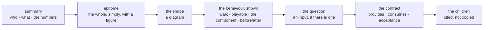

<m-summary ticket="SKILL-3">

<m-answer data-field="answer">**Write a ticket for the moment a person opens it — it shows them how the thing should work, in the first screen, with a picture — and write it so an agent can build and check from the same body.**</m-answer>

<m-stat value="7">beats in the arc</m-stat>
<m-stat value="6">forms, one per kind</m-stat>
<m-stat value="14">rules</m-stat>

</m-summary>

<m-beat data-field="problem" kicker="the look budget" size="lead">

A ticket is only relevant if a human looks at it. Every ticket you file spends some of the owner's attention, and the more you file the less of each one gets read.

**One ticket that shows beats three that tell.**

<svg slot="figure" viewBox="0 0 240 160" role="img" aria-label="nine small pages, one large page with a picture"><g style="fill:none;stroke:var(--muted);stroke-width:1.5"><rect x="14" y="20" width="26" height="34" rx="2"></rect><rect x="48" y="20" width="26" height="34" rx="2"></rect><rect x="82" y="20" width="26" height="34" rx="2"></rect><rect x="14" y="62" width="26" height="34" rx="2"></rect><rect x="48" y="62" width="26" height="34" rx="2"></rect><rect x="82" y="62" width="26" height="34" rx="2"></rect><rect x="14" y="104" width="26" height="34" rx="2"></rect><rect x="48" y="104" width="26" height="34" rx="2"></rect><rect x="82" y="104" width="26" height="34" rx="2"></rect></g><rect x="134" y="20" width="92" height="118" rx="4" style="fill:none;stroke:var(--ink);stroke-width:2.5"></rect><path d="M146 36 H200" style="stroke:var(--ink);stroke-width:4;stroke-linecap:round"></path><rect x="146" y="50" width="68" height="44" rx="3" style="fill:var(--accent)"></rect><path d="M146 108 H214 M146 120 H190" style="stroke:var(--line);stroke-width:3;stroke-linecap:round"></path></svg>

</m-beat>

<m-field data-field="context" label="The look budget, in rules">

- **Count the looks you are asking for.** A plan that needs nine tickets to be understood is read at the scope and skimmed below it; a plan that needs three is read. The DAG may hold nodes that are not yet tickets (<m-ticket ref="VOLT-2"></m-ticket> draws `volt.chargers (not filed)`); a ticket is filed when it is ready to be looked at, not when it is thought of.
- **A thought is a note, not a ticket.** `synapse -P 4455 menger notes add --body "…"` keeps it dated; `notes upgrade` makes it a ticket the day it earns one (<m-ticket ref="TICKETING-9"></m-ticket> was note 1).
- **A walk, a playable, the component in place** replace paragraphs — and the paragraphs they replace were the ones nobody read.
- **No one size fits all.** What a ticket shows depends on what it is about: a backend shows a wire, a frontend shows the page, a schema shows the same fact three ways (<m-ticket ref="SKILL-16"></m-ticket>).

</m-field>

<m-diagram data-field="shape" label="The reader's arc">

The person reads it in this order; the agent reads the `data-field`s in any order. Nothing is written for one at the other's expense.

</m-diagram>

<m-cases label="The arc, beat by beat">

| beat | as | the rule |
| -- | -- | -- |
| the summary | `m-summary ticket=` | the kind and status come free; the standing is one bold sentence true the day the ticket is done; two or three stats that each restate a number from below |
| the epitome | `m-beat size="lead"` with a figure | the simplest concrete picture of the whole — a moment, a person, a number — never an abstraction. A reader who stops here has the point |
| the shape | `m-diagram` / `m-dag` | the picture a stranger could rebuild the design from; one lens per diagram |
| the behaviour, shown | `m-walk` + `m-code`; a playable; the component itself; `m-compare` or `m-cases before= after=` | a walk down one real path; a playable where there is a mechanism; the component where the ticket is a frontend; a before/after where it is a gap. A cases table pins what the reader just saw |
| the question | `m-decision id=` / `m-input id=` | after the reader has seen enough to answer it, before the contract (<m-ticket ref="SKILL-11"></m-ticket>) |
| the contract | `m-provides`, `m-consumes`, `m-acceptance`, `must-not-change` | tables, every row checkable |
| the children | `m-cite` | a scope or execution cites its children's epitomes so the reader descends without leaving the page; it never re-describes them |

</m-cases>

<m-field data-field="detail" label="The epitome, shown">

The first beat of <m-ticket ref="VOLT-1"></m-ticket>: a moment, a count, a consequence, the claim — and a figure of seven cars and two plugs beside it. Compare *"This scope covers the implementation of a queue management subsystem for electric vehicle charging infrastructure in a multi-tenant residential context"*: nothing to see; the reader must build the picture themselves.

<m-cite ref="VOLT-1" field="problem"></m-cite>

</m-field>

<m-cases label="The ladder per kind">

| kind | the reader's question | opens with | shows | lets the reader do | must not show | form |
| -- | -- | -- | -- | -- | -- | -- |
| scope | is this worth it, and what will exist? | the epitome | the end state as a diagram; the decided shape; the language; the children cited | answer the bet or the fork | code, file paths, a DAG | SKILL-4 |
| execution | what is the order, and where does it stand? | the DAG | one walk through all of it; the exit; the live picture (a hill, a dial) | see what is next; open a child | the rationale (the scope's); work of its own | SKILL-5 |
| build | what does it do, and how do I call it? | the problem beat | the cases; the walk; a playable if there is a mechanism; the component itself if it is a frontend; provides/consumes | play it; read the call site | design options (that is a spike or a decision) | SKILL-6 |
| spike | what did we find? | the question | the lens as a figure or a playable; the metric sheet; the DECIDED banner | move the slider; check the command | implementation steps | SKILL-7 |
| gap | what went wrong, and what should happen? | the evidence (a transcript, a number) | a sequence diagram with *today / fixed* notes; a before/after table | see the fix's shape | speculation about cause without evidence | SKILL-8 |
| doc | what is so, and why? | the answer, in one sentence | the same thing from several sides; the sources beside the claims; what was left out | — | a lifecycle | SKILL-9 |

</m-cases>

<m-field data-field="decided-shape" label="Rules">

1. **The epitome comes first and is concrete.** A moment, a person, a number, a figure beside it. If the first screen is a table of fields, the ticket has not been understood as a picture yet.
2. **Show how it should work.** Every ticket of work carries at least one of: a walk with the code, a playable, the component in place, a before/after. Prose about behaviour is the fallback for what none of these can carry.
3. **The shape is a diagram, in the body.** Never behind a link. One lens per diagram; several small diagrams over one that says everything.
4. **A frontend is rendered, not described.** The component the ticket is about is in the body, or the page is the body in `view: mockup` at its widths; failing that, a screenshot in both themes (<m-ticket ref="SKILL-13"></m-ticket>). A frontend ticket with neither is not finished.
5. **A parent cites its children; it never re-describes them.** `m-cite` the child's `standing`, `problem` or `dag`. A paragraph in a scope that paraphrases a build is a copy that will go stale.
6. **Every number is the tracker's or a measurement.** A stat restates a field below; a live component reads `list` and follows `watch`; a playable says it records nothing. No number is typed to impress.
7. **The question is an input, filed on the ticket.** Never only in chat. The agent never answers its own input.
8. **The contract is tables the agent can check.** Provides and consumes name strong types and the ticket that produces each; acceptance is numbered and checkable by running, reading or counting; what must not change is listed.
9. **Specify behaviour, not code** — except in a walk, where the code *is* the behaviour shown, only the lines that prove the step.
10. **Confidence is stated**; `low` means a spike blocks the build.
11. **Created Pending.** The owner promotes to Ready; work does not start on a Pending ticket. A doc is born `Doc` and has no lifecycle.
12. **Look at it before you say it is done.** Screenshot the ticket in both themes and read it as the owner will; a diagram that failed to draw, a figure in a literal colour, a duplicated badge, a wall of prose above the fold — fix them before the look is spent.
13. **One ticket, one decision.** Two open options is a spike or a decision input, not a build.
14. **A ticket that cannot be built as written is patched, not worked around.** Add the finding to `evidence`, state the options, return it to Pending for the owner.

</m-field>

<m-field data-field="detail" label="Behaviour shown, not told">

<m-ticket ref="VOLT-4"></m-ticket>: *Pick a policy. Guess who plugs in last. Then press go.* — a component that runs the evening at sixty times its speed, then a cases table pinning the six behaviours the reader just watched. Told, it would be: *The queue supports FIFO, fairness-based and need-based policies, configurable per hub.* True, and unread.

<m-cite ref="VOLT-4" field="required-behavior"></m-cite>

</m-field>

<m-field data-field="detail" label="When the ticket is a frontend">

The surface is the thing. The ticket carries the component (a `component` block, rendered where the reader expects to see it, with its docs card beside it), or the page as a mockup at the devices it must serve, and the cases table pins what the reader just saw. A theme on the shortcode makes the body look like the product (<m-ticket ref="SKILL-15"></m-ticket>). Where the real component cannot run in the frame — it needs a server, a library, a device — the body holds a screenshot of it running, in both themes, and says what the screenshot cannot show.

</m-field>

<m-field data-field="detail" label="Before filing — the checklist">

1. The first screen: summary, epitome with a figure, the shape.
2. Something shows the behaviour: a walk, a playable, the component, a before/after.
3. The kind's *must not show* column is honoured.
4. Every child is cited, none paraphrased.
5. The question, if any, is an input with an `id`.
6. Provides, consumes and acceptance are tables; each consumed input names its producer.
7. No literal colours; no number not from the tracker or a measurement.
8. The screenshot, both themes, read as the owner.
9. Created `Pending` (a doc: `Doc`), under the right parent, with its blockers.

</m-field>

<m-field data-field="execution">The forms: <m-ticket ref="SKILL-4" full></m-ticket> · <m-ticket ref="SKILL-5" full></m-ticket> · <m-ticket ref="SKILL-6" full></m-ticket> · <m-ticket ref="SKILL-7" full></m-ticket> · <m-ticket ref="SKILL-8" full></m-ticket> · <m-ticket ref="SKILL-9" full></m-ticket>. The components and their markup: <m-ticket ref="SKILL-2"></m-ticket>; which picture: <m-ticket ref="SKILL-13"></m-ticket>; fewer tickets, placed right: <m-ticket ref="SKILL-10"></m-ticket>; per system: <m-ticket ref="SKILL-16"></m-ticket>; the calls: <m-ticket ref="SKILL-17"></m-ticket>.</m-field>
