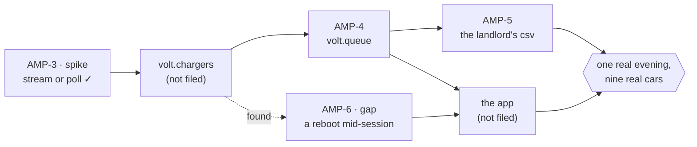

<m-summary ticket="AMP-2">

<m-field data-field="standing">**One evening: nine cars home at six, every one of them charged by morning, and the landlord's CSV right on the first.**</m-field>

<m-stat value="1" tone="pass">spike answered</m-stat>
<m-stat value="0 / 2" tone="info">builds done</m-stat>
<m-stat value="1" tone="warn">gap open</m-stat>

</m-summary>

<m-dag data-field="dag">



✓ is done. A dotted line is something found along the way. The gate at the end is one real evening in the real car park.

</m-dag>

<m-walk kicker="One car, six o'clock to morning" heading="From the plug to the first of the month.">

### The charger says a plug went in.

<m-code lang="text" path="vendor/charger.schema" why="the vendor's, not ours: the one stream per charger">

```text
event   Event   = PlugIn | Meter | PlugOut
command Command = Authorize | Refuse | Query
service Charger { Stream(stream Event) -> stream Command }
```

</m-code>

### The hub asks the queue whose turn it is.

<m-code lang="rust" path="volt/src/chargers.rs" why="the vendor's RPC in, a queue decision out">

```rust
Event::PlugIn(p) => match self.queue.next_for(&p.charger).await {
    Some(turn) => tx.send(Command::authorize(turn.flat)).await?,
    None       => tx.send(Command::refuse("not your turn — 3 ahead of you")).await?,
}
```

</m-code>

### Every phone hears it.

<m-code lang="js" path="app/src/queue.js" why="the app's whole use of volt.queue">

```js
for await (const ev of volt.queue.watch({})) {
  if (ev.type === "charging" && ev.flat === me) notify(`Your plug is live on charger ${ev.charger}`);
  if (ev.type === "moved") board.set(ev.flat, ev.position);
}
```

</m-code>

### A meter reading arrives every ten seconds.

<m-code lang="json" why="one of 8,640 a night, as volt.sessions.watch relays it">

```json
← { "type": "meter", "session": "s_311", "flat": "4B", "kwh": 12.4, "at": "22:14:10" }
```

</m-code>

### On the first, the landlord's cron pulls a file.

<m-code lang="bash" why="AMP-5: the only REST there is">

```bash
curl -sH 'Accept: text/csv' 'https://volt.local/rest/volt/invoices/month?month=2026-09'
flat,sessions,kwh,eur
3B,9,187.2,52.42
```

</m-code>

</m-walk>

<m-field data-field="exit">Done when one real evening goes through it: nine cars home, every one charged by six in the morning, no plug swapped by hand, and the month's CSV adds up to the meter.</m-field>
