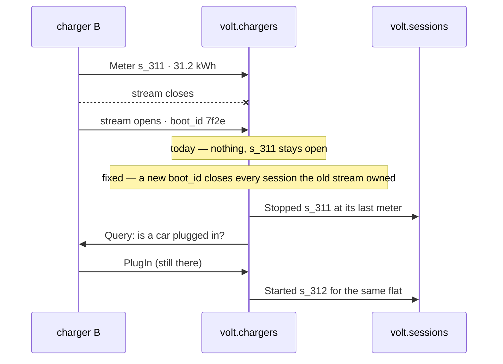

<m-summary ticket="AMP-6">

<m-badge severity="High"></m-badge>

<m-field data-field="standing">**A charger reboots at 02:10, comes back on a new stream, and the session it was running never ends: the flat is billed till morning and the plug is never offered to the next car.**</m-field>

<m-stat value="2 / 14" tone="fail">nights with a ghost session</m-stat>
<m-stat value="27.7 kWh" tone="fail">billed to 4B that nobody drew</m-stat>

</m-summary>

<m-code lang="text" data-field="evidence" why="found soak-testing volt.chargers with the vendor's simulator set to reboot nightly">

```text
02:09:50  B  meter   s_311  kwh 31.2
02:10:03  B  stream closed (EOF)
02:10:41  B  stream opened   boot_id 7f2e          # a new stream: no PlugIn, no PlugOut
02:10:50  B  meter   s_???  kwh 0.0                # the car is still plugged in; the charger forgot
06:00:00  s_311 still open — 4B billed 31.2 → 58.9 kWh; charger B "busy" all night; 2A never offered it
```

</m-code>

<m-diagram data-field="shape" label="What happens, and what should">



A stream is not a session. The charger forgot; the hub must not.

</m-diagram>

<m-cases data-field="problem">

| | before | after |
| -- | -- | -- |
| the stream closes and reopens with a new `boot_id` | s_311 runs until someone unplugs | s_311 stopped at its last meter; the plug is asked again |
| the car is still plugged in after the reboot | metered into the old session, once the charger resends | a new session for the same flat, from 0 |
| the stream closes and reopens with the **same** `boot_id` (a network blip) | as before | the session continues; nothing is closed |
| 4B's bill for the night | 58.9 kWh | 31.2 kWh + what the new session meters |

</m-cases>

<m-acceptance data-field="acceptance">

1. The simulator's nightly reboot runs for 14 nights: no session outlives its stream's `boot_id`.
2. A network blip (same `boot_id`) closes no session.
3. 4B's invoice for a reboot night equals the meter.

</m-acceptance>
