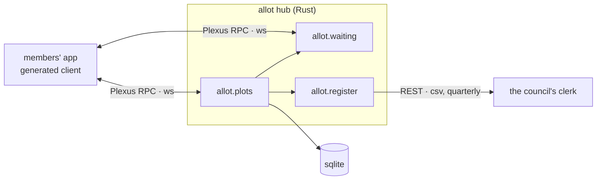

<m-summary ticket="PLOT-1">

<m-badge tone="info">pattern 1</m-badge> <m-badge tone="pass">★★</m-badge>

<m-field data-field="standing">**THE SOCIETY KNOWS ITS PLOTS — which are held, which are empty, and who is waiting.**</m-field>

<m-stat value="31">names waiting</m-stat>
<m-stat value="3" tone="fail">plots empty since March</m-stat>
<m-stat value="3">smaller patterns</m-stat>

</m-summary>

<m-field data-field="context" label="…this pattern is the top of the language">

Nothing larger completes it. Every other pattern in PLOT helps complete this one, and each says so at its head — and returns to this picture before it elaborates.

</m-field>

<m-beat data-field="problem" kicker="the epitome" size="lead">

Plot 14 has been empty since March. The waiting list is thirty-one names long. Nobody knew.

The society keeps a ledger in a shed, a list in the treasurer's drawer, and a whiteboard by the water butt — and **a plot that nobody counts is a plot that stays empty.**

<svg slot="figure" viewBox="0 0 220 160" role="img" aria-label="a grid of allotment plots, three of them empty"><g style="fill:var(--accent);opacity:.85"><rect x="20" y="20" width="40" height="34"></rect><rect x="68" y="20" width="40" height="34"></rect><rect x="116" y="20" width="40" height="34"></rect><rect x="164" y="20" width="40" height="34"></rect><rect x="20" y="62" width="40" height="34"></rect><rect x="116" y="62" width="40" height="34"></rect><rect x="164" y="62" width="40" height="34"></rect><rect x="20" y="104" width="40" height="34"></rect><rect x="68" y="104" width="40" height="34"></rect></g><g style="fill:none;stroke:var(--ink);stroke-width:2;stroke-dasharray:4 4"><rect x="68" y="62" width="40" height="34"></rect><rect x="116" y="104" width="40" height="34"></rect><rect x="164" y="104" width="40" height="34"></rect></g><text x="88" y="84" text-anchor="middle" style="font:600 12px var(--mono);fill:var(--ink)">14</text></svg>

</m-beat>

<m-field data-field="core-transition" label="The problem">

**Three records of the same plots disagree, and the one that is right is the one nobody can see.** The ledger says who pays; the drawer says who waits; the whiteboard says who was there on Sunday. A plot falls between them the day its holder moves away without a word.

</m-field>

<m-field data-field="decided-shape" label="Therefore">

**Keep one record of the plots that the society itself can read — every plot, its holder, its state — and let the waiting list, the rota and the council's register be views of it.** Then:

1. a plot is held by a *person*, never by a number on a map (<m-ticket ref="PLOT-3"></m-ticket>);
2. the waiting list is public, and a name on it can see its own place (<m-ticket ref="PLOT-4"></m-ticket>);
3. the council's register is pulled from the same record once a quarter, never typed again.

</m-field>

<m-diagram data-field="end-state">

One record, two wires out of it: the members hold Plexus streams open; the clerk pulls a CSV.

</m-diagram>

<m-field data-field="detail" label="…the smaller patterns that complete it">

Each is cited here as it stands — not copied; the window follows the pattern. Open one and it returns you to this picture before it elaborates.

<m-cite ref="PLOT-3" field="problem"></m-cite>

<m-cite ref="PLOT-4" field="problem"></m-cite>

<m-cite ref="PLOT-5" field="question"></m-cite>

</m-field>

<m-field data-field="execution"><m-ticket ref="PLOT-2" full></m-ticket> is the sequence: the order in which the patterns are applied. The look is <m-ticket ref="PLOT-6" full></m-ticket>.</m-field>
