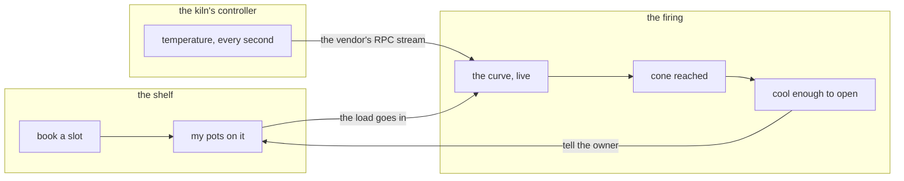

<m-summary ticket="CONE-1">

<m-field data-field="standing">**The studio's kiln runs itself: members book a shelf, the firing streams its own curve, and nobody drives back at eleven to check the cone.**</m-field>

<m-stat value="2 weeks">appetite</m-stat>
<m-stat value="3">scopes on the hill</m-stat>
<m-stat value="1" tone="warn">bet to place</m-stat>

</m-summary>

<kiln-stretch></kiln-stretch>

<m-beat data-field="problem" kicker="kiln · the pitch" size="lead">

Tuesday night. The bisque load went in at six. At eleven someone drives back to check the cone.

The kiln knows its own temperature to the degree, every second. The studio finds out on Wednesday, from a melted shelf. **A firing should be watchable from the sofa.**

<svg slot="figure" viewBox="0 0 220 160" role="img" aria-label="a fat-marker sketch: a kiln, a curve rising, a phone"><path d="M30 130 V60 Q30 40 50 40 H130 Q150 40 150 60 V130 Z" style="fill:none;stroke:var(--ink);stroke-width:6;stroke-linejoin:round;stroke-linecap:round"></path><path d="M30 130 H150" style="stroke:var(--ink);stroke-width:6;stroke-linecap:round"></path><path d="M60 110 C80 110 85 70 100 70 C115 70 120 95 125 95" style="fill:none;stroke:var(--accent);stroke-width:6;stroke-linecap:round"></path><rect x="170" y="70" width="30" height="56" rx="8" style="fill:none;stroke:var(--ink);stroke-width:6"></rect><path d="M178 100 C182 100 183 88 188 88 C192 88 193 94 194 94" style="fill:none;stroke:var(--accent);stroke-width:4;stroke-linecap:round"></path></svg>

</m-beat>

<m-field data-field="status" label="The hill">

<kiln-hill epic="CONE" until="2026-10-27" dots="CONE-4:.46"></kiln-hill>

</m-field>

<m-field data-field="goal" label="Appetite" data-stretch="2">

**Two weeks, one person.** That is a bet, not an estimate: it says how much of the studio's attention this is worth. When it runs out the work stops — the circuit breaker — and whatever is over the hill ships. Nothing is extended.

</m-field>

<m-diagram data-field="end-state" label="Breadboard — places, affordances, connections" data-stretch="2">



A breadboard has no layout: places (the boxes), what you can do there (the words), and what connects. The look is the builder's.

</m-diagram>

<m-field data-field="decided-shape" label="Solution, in fat marker" data-stretch="2">

1. **The controller streams; the hub listens.** The kiln's controller speaks the vendor's binary RPC (`Firing.Stream`) and dials the hub. We never poll a kiln.
2. **The shelf is a calendar of loads**, not of people: a load has an owner and a programme (bisque, glaze), and the kiln fires loads.
3. **One studio per hub.** Members are the studio's; there is no sign-up.

</m-field>

<m-cards data-field="risks" label="Rabbit holes" data-stretch="2">
<m-card headline="The controller's firmware" note="it streams, says the manual; nobody here had seen it stream" fold="what we did">One cold evening with the vendor's command-line client and the manual: <m-ticket ref="CONE-3"></m-ticket>. It streams.</m-card>
<m-card headline="Cool-down" note="the lid can't open above 200 °C, and the curve down is slow and boring" fold="what we'll do">The stream carries it; the app says "cool enough at about 07:40" and nothing else. No alarm design.</m-card>
<m-card headline="Two kilns" note="the studio is buying a second one in spring" fold="what we'll do">Outside the appetite: one kiln, and the shape doesn't forbid a second.</m-card>
</m-cards>

<m-field data-field="left-out" label="No-gos" data-stretch="2">

- No programme editor: the kiln's own controller keeps the programmes.
- No billing, no member accounts, no photos of the pots.
- No second kiln.

</m-field>

<m-code lang="rust" path="kiln-api/src/lib.rs" why="the whole surface, as the app will see it" data-stretch="3">

```rust
kiln.shelf.book     { owner: Member, programme: Programme, day: Day } -> Booked { load } | Full
kiln.firings.watch  { load?: Load }                                   -> (Started | Reading | ConeReached | CoolEnough)*
kiln.firings.last   {}                                                -> Firing
```

</m-code>

<m-decision data-field="decision" id="bet" rows="what ships|what doesn't|cost">

<m-question data-field="question">Bet on this for the next two weeks?</m-question>

<m-option data-field="option" name="Bet" value="bet" recommended what-ships="the curve live, the shelf as a calendar" what-doesnt="anything still uphill on day 14" cost="two weeks of one person"></m-option>
<m-option data-field="option" name="Shelve it" value="shelve" what-ships="nothing" what-doesnt="—" cost="another Tuesday drive"></m-option>

<m-recommendation data-field="recommendation" by="planner">**Bet.** The spike (<m-ticket ref="CONE-3"></m-ticket>) already answered the rabbit hole that mattered — the controller streams — so nothing on the hill is above the midline with an unknown in it.</m-recommendation>

</m-decision>

<m-field data-field="execution"><m-ticket ref="CONE-2" full></m-ticket> is the cycle: its scopes are the dots on the hill. The look is <m-ticket ref="CONE-6" full></m-ticket>.</m-field>

```component kiln-stretch
<template>
<div class="bar" part="bar">
<span class="k" part="label">stretch</span>
<input type="range" min="1" max="3" step="1" value="2" aria-label="how much of the body to show">
<span class="lv" part="level"></span>
<span class="n" part="count"></span>
</div>
</template>
<style>
:host{display:block;margin:.2rem 0 1rem}
.bar{display:flex;flex-wrap:wrap;gap:.6rem 1rem;align-items:center;padding:.5rem .9rem;border:var(--border) solid var(--line);border-radius:var(--radius-pill);background:var(--panel)}
.k{font:var(--weight-strong) calc(11px * var(--text-scale)) var(--sans);letter-spacing:.1em;text-transform:uppercase;color:var(--muted)}
input{flex:0 0 9rem;accent-color:var(--accent)}
.lv{font:var(--weight-medium) calc(14px * var(--text-scale)) var(--font-display);color:var(--ink)}
.n{font:calc(12px * var(--text-scale)) var(--mono);color:var(--muted);margin-left:auto}
</style>
<docs>
  <summary>Nelson's second throttle: a stretch level the whole body follows — the gist, the pitch, or everything. A block marked data-stretch="2" appears from the pitch on, data-stretch="3" only at everything; the level is kept in this browser, so every CONE body opens at the same stretch.</summary>
  <part name="bar">The bar.</part>
  <part name="label">The word "stretch".</part>
  <part name="level">The level's name.</part>
  <part name="count">How many blocks are shown, of how many.</part>
  <example><kiln-stretch></kiln-stretch></example>
  Mark a block in the body with `data-stretch="2"` (the pitch) or `data-stretch="3"` (everything); an unmarked block is the gist and always shows. It hides with one style in the frame's head and records nothing but the level, in localStorage.
</docs>
<script>
const doc = this.ownerDocument, range = this.root.querySelector('input'), lv = this.root.querySelector('.lv'), n = this.root.querySelector('.n');
const NAMES = { 1: 'the gist', 2: 'the pitch', 3: 'everything' }, KEY = 'kiln.stretch';
let style = doc.getElementById('kiln-stretch');
if (!style) { style = doc.createElement('style'); style.id = 'kiln-stretch'; doc.head.appendChild(style); }
const load = () => { try { return +localStorage.getItem(KEY) || 2; } catch { return 2; } };
const save = (v) => { try { localStorage.setItem(KEY, String(v)); } catch {} };
const apply = () => {
  const level = +range.value;
  style.textContent = (level < 3 ? '[data-stretch="3"]{display:none !important}' : '') + (level < 2 ? '[data-stretch="2"]{display:none !important}' : '');
  const all = doc.querySelectorAll('[data-stretch]'), hidden = [...all].filter((el) => +el.getAttribute('data-stretch') > level).length;
  lv.textContent = NAMES[level];
  n.textContent = hidden ? `${all.length - hidden} of ${all.length} blocks · ${hidden} more at “${NAMES[level + 1]}”` : `all ${all.length} blocks`;
};
range.value = load();
range.oninput = () => { save(+range.value); apply(); };
apply();
</script>
```

```component kiln-hill epic=CONE
<template>
<div class="head" part="head"><span class="t">The hill</span><span class="left" part="countdown"></span></div>
<svg viewBox="0 0 600 232" part="hill" role="img" aria-label="the hill chart: a dot per scope; uphill is figuring it out, downhill is making it happen">
<path class="curve"></path>
<line x1="300" y1="30" x2="300" y2="200" class="mid"></line>
<text x="150" y="224" text-anchor="middle" class="lbl">figuring it out</text>
<text x="450" y="224" text-anchor="middle" class="lbl">making it happen</text>
<g class="dots"></g>
</svg>
<p class="note" part="note"></p>
</template>
<style>
:host{display:block}
.head{display:flex;flex-wrap:wrap;justify-content:space-between;align-items:baseline;gap:.4rem 1rem;margin:0 0 .3rem}
.t{font:var(--weight-strong) calc(15px * var(--text-scale)) var(--font-display);color:var(--ink)}
.left{font:var(--weight-medium) calc(12.5px * var(--text-scale)) var(--mono);color:var(--accent)}
.left.over{color:var(--err-fg)}
svg{width:100%;height:auto;display:block}
.curve{fill:none;stroke:var(--line);stroke-width:3}
.mid{stroke:var(--line);stroke-dasharray:3 5}
.lbl{font:calc(12px * var(--text-scale)) var(--sans);fill:var(--muted)}
.dot circle{fill:var(--accent);stroke:var(--bg);stroke-width:2;cursor:pointer;transition:r var(--motion-fast) var(--ease)}
.dot.done circle{fill:var(--live)}
.dot.pending circle{fill:var(--card);stroke:var(--muted)}
.dot text{font:var(--weight-medium) calc(11.5px * var(--text-scale)) var(--mono);fill:var(--ink);cursor:pointer}
.dot:hover circle{r:9}
.note{margin:.3rem 0 0;font:calc(12.5px * var(--text-scale)) var(--sans);color:var(--muted)}
</style>
<docs>
  <summary>The hill chart, live over a shortcode: one dot per build, spike or gap, placed by its status — Pending at the foot, Ready and Coding uphill, In Review over the top, Complete at the bottom of the far side — unless the owner places it with dots="ID:0.6". A click opens the ticket; the dots follow watch; the header counts the cycle's days down.</summary>
  <attr name="epic" type="string">The shortcode whose tickets are the dots (default CONE).</attr>
  <attr name="dots" type="string">Owner placements, 0 (the foot, uphill) to 1 (the foot, downhill): "CONE-4:.46 CONE-5:.1". A placed dot beats its status, and says so on hover.</attr>
  <attr name="until" type="string">The cycle's last day, YYYY-MM-DD: the header counts the days left, and says so when they have run out.</attr>
  <part name="head">The title and the countdown.</part>
  <part name="countdown">Days left in the cycle.</part>
  <part name="hill">The hill and its dots.</part>
  <part name="note">The legend.</part>
  <example><kiln-hill epic="CONE" until="2026-10-27"></kiln-hill></example>
  Reads `list { epic, summary }` once over the read-only bridge and follows `watch`. A number never lies: hover a dot and it says whether its status or the owner put it there.
</docs>
<script>
const epic = (this.attr('epic') || 'CONE').toUpperCase(), until = this.attr('until');
const placed = Object.fromEntries((this.attr('dots') || '').split(/\s+/).filter(Boolean).map((s) => { const [id, t] = s.split(':'); return [id.toUpperCase(), Math.min(1, Math.max(0, +t))]; }));
const BY = { Pending: .06, Blocked: .1, Ready: .18, Coding: .4, 'In Review': .66, Complete: .94 };
const $ = (q) => this.root.querySelector(q), dots = $('.dots'), note = $('.note'), left = $('.left');
const y = (t) => 196 - 150 * Math.exp(-(((t - .5) / .24) ** 2));
$('.curve').setAttribute('d', Array.from({ length: 61 }, (_, i) => `${i ? 'L' : 'M'}${(20 + i * 560 / 60).toFixed(1)} ${y(i / 60).toFixed(1)}`).join(' '));
if (until) {
  const days = Math.ceil((new Date(until + 'T23:59:59') - Date.now()) / 864e5);
  left.textContent = days > 0 ? `${days} day${days === 1 ? '' : 's'} left in the cycle` : 'the cycle is over — the circuit breaker';
  left.classList.toggle('over', days <= 0);
}
let rows = [];
const draw = () => {
  const work = rows.filter((r) => ['build', 'spike', 'gap'].includes(r.kind));
  dots.innerHTML = '';
  work.map((r) => ({ r, t: placed[r.id] ?? BY[r.status] ?? .06, by: placed[r.id] != null ? 'the owner' : 'its status' }))
    .sort((a, b) => a.t - b.t)
    .forEach((d, i) => {
      const x = 20 + d.t * 560, cy = y(d.t), g = document.createElementNS('http://www.w3.org/2000/svg', 'g');
      g.setAttribute('class', 'dot ' + (d.r.status === 'Complete' ? 'done' : d.r.status === 'Pending' ? 'pending' : ''));
      g.innerHTML = `<title>${d.r.id} · ${d.r.status} · placed by ${d.by} · ${d.r.title}</title><circle cx="${x.toFixed(1)}" cy="${cy.toFixed(1)}" r="7"></circle><text x="${x.toFixed(1)}" y="${(cy - 13 - (i % 2) * 14).toFixed(1)}" text-anchor="middle">${d.r.id}</text>`;
      g.onclick = () => this.menger.navigate('#/ticket/' + d.r.id);
      dots.append(g);
    });
  const done = work.filter((r) => r.status === 'Complete').length;
  note.textContent = `${work.length} scopes · ${done} over the hill and down · ${Object.keys(placed).length} placed by the owner, the rest by status. A dot you can't place is a list that wants splitting.`;
};
const load = () => this.menger.call('list', { epic, summary: true, limit: 200 }).then((items) => {
  rows = items.map((x) => x && (x.summary || x.ticket)).filter(Boolean);
  draw();
}, (e) => { note.textContent = 'the tracker did not answer: ' + ((e && e.message) || e); });
load();
return this.menger.on('change', (ev) => { const t = ev && ev.ticket; if (t && String(t.id).toUpperCase().startsWith(epic + '-')) load(); });
</script>
```
