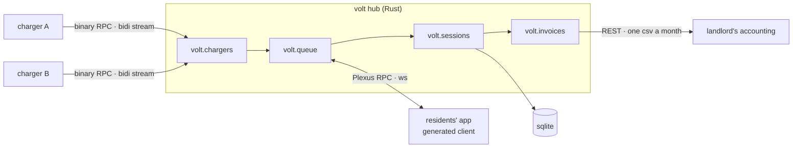

<m-summary ticket="AMP-1">

<m-field data-field="standing">**Nine flats share two chargers, and nobody sits in the car park waiting for a plug.**</m-field>

<m-stat value="3">wires, one hub</m-stat>
<m-stat value="2 / 9">chargers for flats</m-stat>
<m-stat value="1" tone="warn">decision open</m-stat>

</m-summary>

<m-beat data-field="problem" kicker="volt" size="lead">

Six o'clock. Nine cars come home. Two of them can plug in.

The other seven park, and someone goes down at eleven to swap the plug — or doesn't, and the car is flat in the morning. **The building should run the queue, not the residents.**

<svg slot="figure" viewBox="0 0 240 140" role="img" aria-label="nine cars home, two chargers: two plugged in, seven waiting"><path d="M10 124 H230" style="fill:none;stroke:var(--ink);stroke-width:2;stroke-linecap:round"></path><rect x="30" y="52" width="12" height="72" rx="3" style="fill:var(--ink)"></rect><rect x="130" y="52" width="12" height="72" rx="3" style="fill:var(--ink)"></rect><path d="M42 70 Q60 70 62 100" style="fill:none;stroke:var(--accent);stroke-width:2"></path><path d="M142 70 Q160 70 162 100" style="fill:none;stroke:var(--accent);stroke-width:2"></path><rect x="50" y="100" width="36" height="20" rx="6" style="fill:var(--accent)"></rect><rect x="150" y="100" width="36" height="20" rx="6" style="fill:var(--accent)"></rect><g style="fill:none;stroke:var(--ink);stroke-width:2"><rect x="12" y="14" width="26" height="16" rx="5"></rect><rect x="44" y="14" width="26" height="16" rx="5"></rect><rect x="76" y="14" width="26" height="16" rx="5"></rect><rect x="108" y="14" width="26" height="16" rx="5"></rect><rect x="140" y="14" width="26" height="16" rx="5"></rect><rect x="172" y="14" width="26" height="16" rx="5"></rect><rect x="204" y="14" width="26" height="16" rx="5"></rect></g></svg>

</m-beat>

<m-diagram data-field="end-state">



Three wires, each the native tongue of whoever is on the other end: the chargers speak the vendor's binary RPC and nothing else; the residents' app holds two Plexus streams open all evening; the landlord's cron pulls a CSV on the first.

</m-diagram>

<m-field data-field="decided-shape">

1. **The chargers dial in.** They speak the vendor's `Charger` schema over its binary RPC; the hub is the RPC *server* and never polls. Owner: *"we don't own the firmware; we own the socket it connects to."*
2. **The queue is the product.** A charger is a resource; `volt.queue` decides who gets it, and the app only ever watches and asks.
3. **One building per hub.** No tenants in v1; the hub is the building.
4. **The landlord's surface is read-only, and it is the bridge.** Invoices are pulled, never pushed — one CSV a month — and it is the Plexus REST bridge wearing a content type, not a second server (<m-ticket ref="AMP-5"></m-ticket>).

</m-field>

<m-code lang="rust" path="volt-api/src/lib.rs" why="everything the app can ask">

```rust
volt.queue.join      { flat: Flat, needs_kwh: u32 }   -> Queued { position } | Charging { charger }
volt.queue.leave     { flat: Flat }                     -> Left
volt.queue.watch     {}                                 -> (Moved | Charging | Done)*
volt.sessions.watch  { flat?: Flat }                    -> (Started | Meter | Stopped)*
volt.invoices.month  { month: Month }                   -> InvoiceRow*
```

</m-code>

<m-decision data-field="decision" id="policy" rows="who waits|who is happy|cost">

<m-question data-field="question">When both chargers are busy and a third car arrives, who gets the next free plug?</m-question>

<m-option data-field="option" name="First come, first served" value="fifo" who-waits="whoever got home late" who-is-happy="the early home" cost="shift workers never charge"></m-option>
<m-option data-field="option" name="Least charged this week" value="fair" recommended who-waits="whoever charged most recently" who-is-happy="everyone, over a week" cost="a counter per flat, and an argument about it"></m-option>
<m-option data-field="option" name="Emptiest battery first" value="need" who-waits="whoever has range left" who-is-happy="the empty car" cost="the car must tell us, and most don't"></m-option>

<m-recommendation data-field="recommendation" by="planner">**Least charged this week.** <m-ticket ref="AMP-4"></m-ticket> lets you play the three against one evening of real homecomings — guess, press go, then decide here.</m-recommendation>

</m-decision>

<m-field data-field="language">

- **flat** — a resident's unit; the identity that joins the queue. The car is not the identity: two cars, one flat, one place in line. NEW → `Flat` newtype.
- **session** — one plug-in to unplug on one charger, metered. Glossary ✓ (the vendor's *transaction*).
- **turn** — a flat's place in the queue, with its promised kWh. NEW → `Turn`.

</m-field>

<m-field data-field="execution"><m-ticket ref="AMP-2" full></m-ticket> takes one evening, six o'clock to six in the morning, through all of it. <m-ticket ref="AMP-7" full></m-ticket> shows one meter reading on each of the three wires.</m-field>

<m-field data-field="detail" label="Zoom in — the children, from inside the parent">

The plan's shape, as <m-ticket ref="AMP-2"></m-ticket> keeps it — not a copy: the window follows the child live.

<m-cite ref="AMP-2" field="dag"></m-cite>

The queue, as <m-ticket ref="AMP-4"></m-ticket> lets you play it — pick a policy, guess, press go — without leaving the scope:

<m-cite ref="AMP-4" field="intended-usage"></m-cite>

</m-field>
