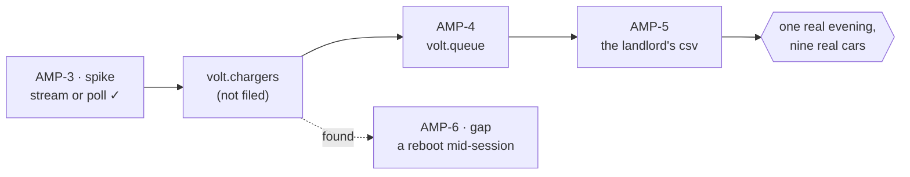

<m-summary>

<m-answer data-field="answer">**The execution — *what is the order, and where does it stand?* — holds the DAG and owns the work as children. It is a pure container, the one page that shows the whole route: the DAG first, then one real thing walked through every wire with the code at each step, then the exit a person could check.**</m-answer>

<m-stat value="1">walk, through all of it</m-stat>
<m-stat value="(not filed)">a node not yet worth a look</m-stat>

</m-summary>

<m-field data-field="context" label="What it opens with">

The DAG, in an `m-dag`, in the body. Then **one walk through all of it**: one car, one roast, one request — followed from the first wire to the last — so the reader sees the system work before they see the ticket list.

The execution example's `dag`: [examples/execution.md](examples/execution.md) (`shots/execution.png`).

</m-field>

<m-field data-field="detail" label="Skeleton">

`````markdown
<m-summary ticket="AMP-2">

<m-field data-field="standing">**One evening: nine cars home at six, every one of them charged by morning.**</m-field>

<m-stat value="1" tone="pass">spike answered</m-stat>
<m-stat value="0 / 2" tone="info">builds done</m-stat>
<m-stat value="1" tone="warn">gap open</m-stat>

</m-summary>

<m-dag data-field="dag">



✓ is done. A dotted line is something found along the way. A node marked *(not filed)* is a ticket not yet worth a look. The gate at the end is what done means.

</m-dag>

<m-walk kicker="One car, six o'clock to morning" heading="From the plug to the first of the month.">

### The charger says a plug went in.

<m-code lang="text" path="vendor/charger.schema" why="the vendor's, not ours">

```text
…only the lines that prove the step…
```

</m-code>

### The hub asks the queue whose turn it is.

…one step per wire, to the end…

</m-walk>

<m-cases data-field="work">

| ticket | kind | one line | provides → consumed by |
| -- | -- | -- | -- |
| AMP-3 | spike | stream or poll? | the stream → AMP-4 |
| AMP-4 | build | `volt.queue` | `Turn`, `Session` → AMP-5 |

</m-cases>

<m-field data-field="decision-gates">

- *Which policy?* — open, as `policy` on AMP-1; AMP-4 lets the owner play it first.

</m-field>

<m-field data-field="exit">Done when one real evening goes through it: nine cars home, every one charged by six, no plug swapped by hand, and the month's CSV adds up to the meter.</m-field>

<m-field data-field="completion-gate">The evening above, replayed against the built hub; every `consumes` resolved to a `provides`; no structure produced twice.</m-field>
`````

</m-field>

<m-callout type="warning" headline="Must not show">The rationale (the scope's — cite it), work of its own, a second copy of a child's contract. A step of the walk shows the code of the child that owns it, named by path.</m-callout>

<m-field data-field="detail" label="Live">

The DAG is live in the sense that it never lags the children: a build added, removed, promoted or re-sequenced is drawn on the parent in the same write that files it. The picture of progress can be live too — a hill over the execution's scopes (the pitch example's `kiln-hill`, [examples/pitch.md](examples/pitch.md)), a dial, a sponge — reading `list` under the execution and following `watch`.

</m-field>

<m-field data-field="decided-shape" label="Fewer tickets">

A node in the DAG that is understood but not yet needed stays a node, labelled *(not filed)*. It becomes a ticket when the work before it has landed and someone is about to look at it. The owner reads one page and sees the whole route; the tracker holds only the tickets that are live.

</m-field>

<m-field data-field="detail" label="The walk, as the execution example does it">

Open [examples/execution.md](examples/execution.md) for the walk itself: five steps, five wires, the code of each — and its `exit`, the one real evening a person could check.

</m-field>

<m-field data-field="exit" label="Done when">Every leaf fed the completion gate; the exit holds; the findings worth keeping are filed as docs under it (<a href="../reporting/SKILL.md">reporting</a>). The pipeline sets `Complete`.</m-field>
