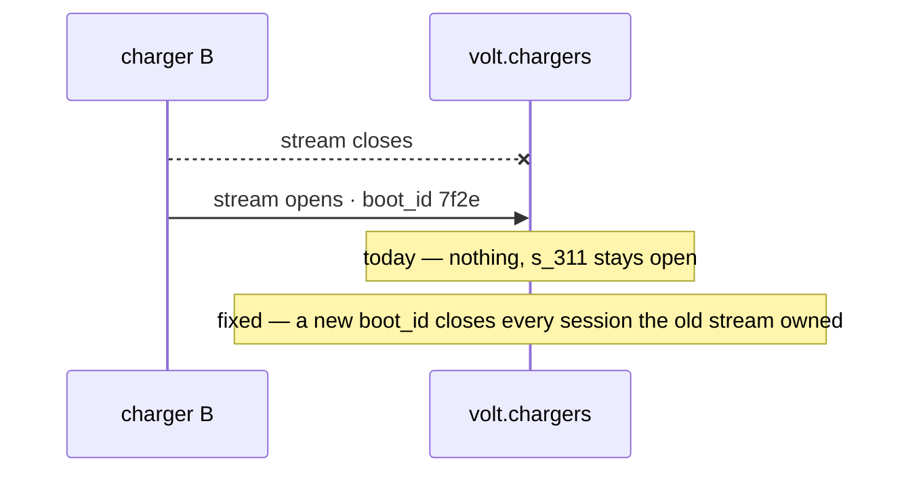

<m-summary>

<m-answer data-field="answer">**The gap — *what went wrong, and what should happen?* — is a difference between what the system does and what it should, with a severity. It opens with the evidence as found — the transcript, the number — and shows the fix's shape on one diagram with *today* and *fixed* as notes, then a before/after table whose last row is the one the owner cares about.**</m-answer>

<m-stat value="1">diagram, today and fixed on it</m-stat>
<m-stat value="✗ → ✓">the table's last column</m-stat>

</m-summary>

<m-field data-field="context" label="What it opens with">

The standing says what happens and what it costs, in one breath. The stats are the damage, measured. Then the evidence as a code block — the log, the request, the row — *as found*.

The gap example opens so — its `standing`, then its `evidence`: [examples/gap.md](examples/gap.md) (`shots/gap.png`).

</m-field>

<m-field data-field="detail" label="Skeleton">

`````markdown
<m-summary ticket="AMP-6">

<m-badge severity="High"></m-badge>

<m-field data-field="standing">**What happens, and what it costs.**</m-field>

<m-stat value="2 / 14" tone="fail">nights with a ghost session</m-stat>
<m-stat value="27.7 kWh" tone="fail">billed to 4B that nobody drew</m-stat>

</m-summary>

<m-code lang="text" data-field="evidence" why="found soak-testing with the vendor's simulator set to reboot nightly">

```text
02:09:50  B  meter   s_311  kwh 31.2
02:10:03  B  stream closed (EOF)
02:10:41  B  stream opened   boot_id 7f2e        # no PlugIn, no PlugOut
06:00:00  s_311 still open — 4B billed 31.2 → 58.9 kWh
```

</m-code>

<m-diagram data-field="shape" label="What happens, and what should">



A stream is not a session. The charger forgot; the hub must not.

</m-diagram>

<m-cases data-field="problem">

| | before | after |
| -- | -- | -- |
| the stream reopens with a new `boot_id` | s_311 runs until someone unplugs | s_311 stopped at its last meter |
| the stream reopens with the **same** `boot_id` | as before | the session continues |
| 4B's bill for the night | 58.9 kWh | 31.2 kWh + the new session |

</m-cases>

<m-acceptance data-field="acceptance">

1. The simulator's nightly reboot runs for 14 nights: no session outlives its stream's `boot_id`.
2. A network blip closes no session.
3. 4B's invoice for a reboot night equals the meter.

</m-acceptance>
`````

</m-field>

<m-field data-field="decided-shape" label="The two pictures">

1. **The sequence, with *today* and *fixed* as notes** on the same diagram — never a before diagram and an after diagram the reader must overlay.
2. **The before/after table** (`m-cases` marks the columns ✗ and ✓): each row a fact the fix changes, the last row the one the owner cares about (the bill).

Both, as the gap example draws them: its `shape` and its `problem`, [examples/gap.md](examples/gap.md).

</m-field>

<m-callout type="warning" headline="Must not show">Speculation about cause without evidence; a fix described as code; a severity with no number behind it. If the cause is not known, the gap's child is a spike.</m-callout>

<m-field data-field="detail" label="From the parent">A scope or execution that found a gap draws it on the DAG as a dotted edge (*found*) and cites its `standing`: the reader of the parent learns what went wrong in one line and descends if they must.</m-field>

<m-field data-field="exit" label="Done when">The acceptance list holds; the before/after table reads ✓ down the last column; the step that fixed it is on the timeline with its commits.</m-field>
