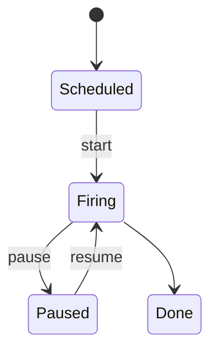
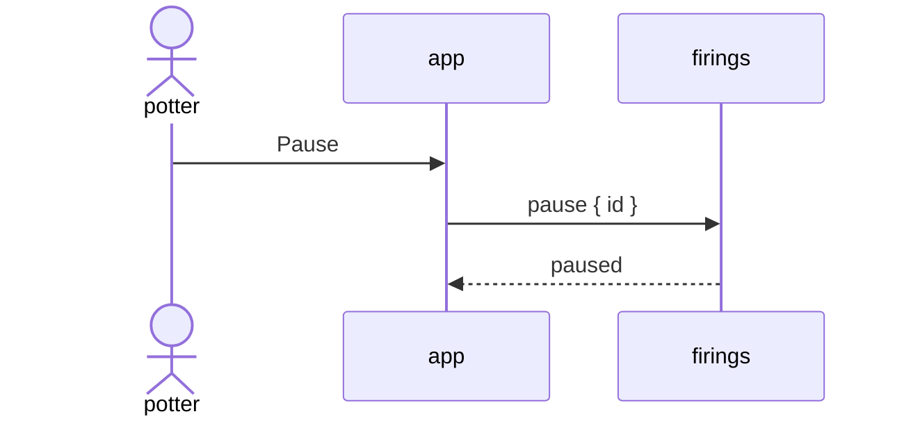

<m-summary>

<m-answer data-field="answer">**A spec is the scope of a feature someone will use, written in OpenSpec's shape: why, what changes, requirements as *SHALL*s each proved by *WHEN … THEN* scenarios, then the design drawn — the state machines, the endpoints, the sequences that matter most — and a mockup of how it is used. The builds are its children, and a build is done when the scenarios under its requirements hold as tests.**</m-answer>

<m-stat value="scope">its kind; a spec is a scope's form</m-stat>
<m-stat value="3">pictures: machines, endpoints, sequences</m-stat>
<m-stat value="1">mockup, a child doc</m-stat>

</m-summary>

<m-field data-field="context" label="When a scope is a spec">

When the owner says a feature is to be specified ("base it on open spec"), and whenever a scope adds a surface — methods, a filter cell, a view — that people and agents will call and look at. A scope that only places a bet stays a pitch ([scope](scope.md)).

The spec is the scope's body. It is written before its builds are promoted, and it is iterated in place until every requirement has scenarios and every open edge is an input.

</m-field>

<m-cases data-field="detail" label="The sections, in order">

| section | `data-field` | holds |
| -- | -- | -- |
| summary | `standing`, `confidence` | one sentence that is true the day it is done; what is decided and what is open; the builds and the mockup as chips |
| how to read it | `reading` | one paragraph: the order below, and that a build is done when its scenarios hold |
| decided | `decided` | the owner's answers as a table: choice · answer · so |
| why | `problem` | the owner's words, the numbers, what is wrong today |
| what changes | `changes` | the store, the wire, every read, the app, and what is **not** changed |
| requirements | `requirements` | `### Requirement: <name>`, one paragraph with *SHALL*, then `#### Scenario: <name>` with **WHEN** / **THEN** bullets; concrete ids from one worked project, never "a ticket" |
| design | `design` | the state machines (`stateDiagram-v2` in `m-diagram`: each thing that has states, the write itself, and the app's flow), the endpoints (a table: method · params with types and defaults · answers · grant; then the surface as one `m-code` block), and a `sequenceDiagram` for each flow that matters most — the main write from the app, the way back, the read path, the agent's loop |
| how it is used | `usage` | the mockup cited, and a line per person who will use it: what they do, in what order |
| tasks | `tasks` | the builds, each with the requirements it covers |
| open questions | `open` | each edge the spec found, as an `m-decision` with its recommendation |

</m-cases>

<m-field data-field="detail" label="The mockup">

A child doc of the spec whose body is a whole document (`<!doctype html>`, `<meta name="menger-view" content="mockup">`): the app's own tokens and fonts, light and dark, every screen the requirements name drawn as a numbered figure with a caption — the action, the warning, the state after, the way back, the view where the new thing is listed. Synthetic ids from the same worked project as the scenarios. It is looked at in a browser, both themes, before the spec cites it.

</m-field>

<m-field data-field="detail" label="Skeleton">

`````markdown
<m-summary>
<m-field data-field="standing">**One sentence that is true the day this is done.**</m-field>
<m-field data-field="confidence">What is decided, what is open. The builds: <m-ticket ref="KILN-2"></m-ticket> … The mockup: <m-ticket ref="KILN-5"></m-ticket>.</m-field>
</m-summary>

<m-field data-field="requirements" label="Requirements">

### Requirement: A firing can be paused

The kiln SHALL hold its temperature when a firing is paused, and SHALL resume the schedule where it stopped.

#### Scenario: paused at the hold
- **WHEN** firing KILN-F7 is paused at 1040 °C
- **THEN** it holds 1040 °C ± 5, and `get` answers `paused: { at_unix, by }`

</m-field>

<m-field data-field="design" label="Design">

<m-diagram data-field="shape" label="A firing">



</m-diagram>

| method | params | answers | grant |
| -- | -- | -- | -- |
| `firings.pause` | `id: FiringId` · `message?: Text` | `paused { firing }` · `refused { reasons }` | editor |

<m-diagram data-field="shape" label="Pausing from the app">



</m-diagram>

</m-field>
`````

</m-field>

<m-field data-field="exit" label="Done when">Every requirement has a scenario a test can be written from; every diagram parses (`synapse -P 4458 diagrams mermaid check --markdown "$(cat spec.md)"`); every endpoint has its params, answers and grant; the mockup draws every screen the requirements name; and what is still open is an input on the spec. Then the builds are written from it, citing the requirements they cover.</m-field>
